<p align="center">
  
</p>
<h1 align="center">Lazulite Studio</h1>
<p align="center">
  基于 TTML 歌词格式的打轴工具，集丰富的歌词编辑能力、精确打轴、自动化工具为一体。
</p>

---
## 项目简介

本项目受 [Apple Music-like Lyrics TTML Tool](https://github.com/amll-dev/amll-ttml-tool) 、[StrangeUtaGame](https://github.com/karaoke-studio/StrangeUtaGame) 、[MiliKara](https://github.com/BilyHurington/MiliKara) 的启发，旨在提供一个 [AMLL TTML Tool](https://github.com/amll-dev/amll-ttml-tool) 编辑能力的超集、以及功能强大的针对歌词编辑、打轴的自动化工具。

## 为什么使用 TTML
Lazulite Studio 使用 [TTML2](https://www.w3.org/TR/ttml2/) 格式作为内部歌词格式与主要交换格式，这是由于 TTML2 提供了一个标准且可扩展的歌词字幕模型，能够承载远超原始 LRC 和各类基于 LRC 的扩展格式的数据和结构，包括但不限于：
- 完善的注音（Ruby）结构支持
- 完整的，独立的行级、词级、注音（Ruby）级时间
- 时间轴几乎无任何限制，能够支持叠唱、重唱、非单调时间
- 稳定的行级 ID，原生能够表达引用、从属等结构
- 背景行指定以及从属主行结构
- 无上限的、可分别指定语言（建议使用 BCP 47 标准）的独立翻译和音译轨道，支持与正文的从属关系和与正文独立的行级和词级时间
- 原生的演唱者字段，使用稳定的 ID 管理引用，并且能够表达虚拟角色与其声优的扮演关系并区分两者
- 精细到词级的演唱者指定

还有一些 Lazulite Studio 暂不提供编辑能力，但 TTML 能够原生承载的数据，为下游的各类工具提供了极大的扩展性：
- 颜色、位置、动画等字幕样式
- 更丰富的注音（Ruby）容器与布局，如同时在上下显示注音（Ruby）
- 引用外部图片资源

TTML 标准的以上特性，使得它非常适合作为围绕歌词的各类工具和应用（例如播放器、卡拉 OK 视频制作工具）之间的交换格式，因此笔者提倡这类项目的开发者能够将 TTML 加入支持格式，以方便不同工具之间的上下游衔接。

Lazulite Studio 也支持导入和导出各种格式的歌词，但相比 TTML，这些格式都会不可避免地损失或多或少的信息。

## 功能特性
### 歌词获取
支持从网易、QQ、酷狗、AMLL TTML DB 四个在线源搜索和获取歌词，并能保留其提供的词级时间和音译/翻译行；同时支持读取音频文件内嵌歌词，以及导入本地歌词文件（含 TTML、各类 LRC/扩展 LRC、SUG 0.3.0 项目文件）或直接粘贴纯文本。

### 音频处理
以 [Lazulite](https://github.com/wuchenyanmo/Lazulite) Python 库作为后端，支持人声分离（使用默认的 [Demucs](https://github.com/adefossez/demucs) 或可选的 [BS-RoFormer-karaoke](https://huggingface.co/becruily/bs-roformer-karaoke)）、外部人声上传与偏移估算、声学分析分片、人声能量与声谱图、全局及局部自动对齐等功能。

### 编辑与打轴
提供简洁与高级两种编辑视图，以及多种自动化工具（可参阅[下一小节](README.md#自动化工具)的详细说明）。打轴界面支持 StrangeUtaGame（单键配合起止点、词内节奏点与终止点）和 AMLL（起始、连续、结束三键）两种打轴风格，支持单行打轴、A/B 区段循环与定位回听校准，并可在时间轴上对照声谱图直接微调边界。

### 文件导出与打包
支持导出 TTML、各类普通或逐字 LRC（LRC / 扩展 LRC / ESLRC / QRC / YRC / LYS）以及 ASS 字幕，并提供针对目标格式的实时问题检查。音乐文件嵌入支持向 MP4/M4A 文件的 STPP 歌词轨道写入 TTML 内嵌歌词（可配合 [Musicovite](https://github.com/zet-wu/Musicovite) 本地音乐播放器使用），也支持向 MP3 USLT、FLAC LYRICS、MP4/M4A ©lyr 元数据标签写入普通或扩展 LRC，兼容大部分播放器。

### StrangeUtaGame / Lin-K 兼容
支持导出 SUG 0.3.0 项目文件，可直接导入现代化的卡拉 OK 视频制作工具 [Lin-K](https://github.com/karaoke-studio/karaoke-studio) 中，支持导唱符、分组文件输出和独立的翻译与音译轨道文件，并支持同一个歌手在不同分组和轨道中输出不同的演唱者字段，方便在 Lin-K 中按分轨调整样式。

### NicoKaraMaker 3 兼容
支持导出能够输入到 [NicoKaraMaker 3](https://github.com/shinta0806/NicoKaraMaker3) 中的歌词文件，支持写入演唱者标记（借鉴自 [StrangeUtaGame](https://github.com/karaoke-studio/StrangeUtaGame)），支持分组文件输出以及独立的翻译和音译轨道文件。

### [Apple Music Like Lyric](https://github.com/amll-dev/applemusic-like-lyrics) 生态兼容
Lazulite Studio 尽量产出兼容 AMLL 生态的 TTML 歌词，然而，由于 AMLL 对 TTML 的歌词模型做了一定的简化，舍弃了一些本项目认为很有用的数据承载能力，因此 Lazulite Studio 不保证其产物能够完整无损地被 AMLL 生态系列工具和库导入，也不保证其格式完全符合 [AMLL TTML DB](https://github.com/amll-dev/amll-ttml-db) 投稿的要求，若有较高的对 AMLL 兼容的要求，可以调整设置中的“AMLL 兼容设置”项。

### AI / MCP 工具接入
内置 MCP（Model Context Protocol）服务，可将歌词读写、自动注音、人声分离、全局与局部自动对齐、局部声谱图查看及音频片段听审等能力暴露给支持 MCP 的外部 AI 客户端，辅助完成歌词校对与时间轴精修。

## 自动化工具

### 智能日文注音
本功能基于 [Sudachi](https://github.com/WorksApplications/SudachiPy) 和 [JmdictFurigana](https://github.com/Doublevil/JmdictFurigana)，为日文汉字及阿拉伯数字（含常见量词音变）提供高准确率、细粒度的假名注音，并且不依赖 Windows 日语语言包和外部 LLM 调用。同时支持自动拆分或合并正文词。

### 词典注音
本功能基于从已有网络数据来源中转换得到的专有格式词典来对正文进行注音，旨在提供通用的、不同语言/方言的自动注音功能。目前本地包附带两个词典：普通话汉语拼音和粤语粤拼。除此之外，[词典仓库](https://github.com/zet-wu/Lazulite-studio-dict) 提供了 8 种不同地区口音的潮州话词典，同时维护词典的格式要求以及构建指南，有兴趣的开发者可以构建自己的词典包或为仓库贡献。

### 自动对齐
Lazulite Studio 提供基于两个 Wav2Vec CTC 对齐模型的自动对齐功能，分别是通用的 [MMS_FA](https://docs.pytorch.org/audio/main/generated/torchaudio.pipelines.MMS_FA.html) 和针对日语歌唱后训练的 [NextFire/mms-300m-ForcedAligner-karaoke-ja-Latn](https://huggingface.co/NextFire/mms-300m-ForcedAligner-karaoke-ja-Latn)（简称 NextFire-karaoke-ja-Latn）。结合自动注音功能，能够完成从歌词正文到细粒度逐读音时间轴的全自动化流程，与 [MiliKara](https://github.com/BilyHurington/MiliKara)、[Timing](https://github.com/Zennmn/Timing)、[StrangeUtaGame](https://github.com/karaoke-studio/StrangeUtaGame)、[yohane](https://github.com/Japan7/yohane) 和 [FA-Kara](https://github.com/moriwx/FA-Kara) 几个已有的歌曲对齐项目比较，在 20 首日语歌曲（含 8 首主唱与背景人声叠唱曲目）和 6 首跨语种/方言歌曲（国语、粤语、日粤混合、潮州话）组成的测试集上，Lazulite Studio 的多项指标均做到最佳，详见下图：

人工读音 + 各自分离器（Lazulite Studio 分别测试默认的 Demucs 与可选的 BS Karaoke）：共同正文边界的误差指标：


由于某些工具在对齐时会将某些读音单元合并（如长音、促音等），因此输出的总单元数量，即准确率的分母会不一致。共同正文边界即指将所有路线的结果的单元边界取交集，仅计算这些共同边界的准确率。
图中 `*` 标记各指标最佳值：命中率越高越好，平均绝对误差与绝对误差 P95 越低越好，以下两图相同，不再赘述。

人工读音 + 统一 BS Karaoke 分离器：共同正文边界的误差指标，此组衡量剔除人声分离器的差异后的各路线对齐效果：


自动分词注音 + 各自分离器：人工读音边界的误差指标，此组衡量在完全自动化情形下，从无注音、无分词的歌词正文开始进行分词、注音、对齐的最终效果（由于部分工具的自动分词器会将多个汉字词合并为长片段导致共同正文边界大幅缩水，此图直接采用全部 8,909 个人工读音单元边界，对比内置完整细粒度自动注音的 6 条路线）：


详细的测试集、方法和结果见 [歌词自动对齐管线探索仓库](https://github.com/zet-wu/lyric-auto-report)。在此基础上还有两项值得注意的结论：
- **跨语种与方言支持**：尽管这一功能最初是为日语歌曲所设计和调试，但结合词典注音给出合适的拉丁化拼音后，使用通用 `MMS_FA` 模型并开启“智能延长结束时间”，在国语、粤语、日粤混合及潮州话测试歌曲上均可稳定达到 82% 以上的双端 100 ms 命中率，接近日语专用模型 `NextFire-karaoke-ja-Latn` 在日语歌曲上的表现。
- **跨模型局部重算**：日语歌曲首轮使用 `NextFire-karaoke-ja-Latn` 对齐后，若个别行在长音或连续相同元音处出现挤缩偏差，可在编辑器或时间轴中选中这些异常行/词，换用 `MMS_FA`（开启智能延长结束时间）执行局部自动对齐。实验表明这种跨模型局部重算在 Demucs 与 BS Karaoke 下可进一步将全集双端 100 ms 命中率提升至 85.91% 与 88.06%。详细的自动对齐步骤与建议可以参见教程中的[音频处理与自动对齐](docs/tutorials/2-audio-and-alignment.md#studio-对齐流程及建议)。

## 本地包安装与使用

下载适合系统的 7z 包：
- Windows CPU 版：`LazuliteStudio-windows-x64-cpu.7z`
- Windows cuda 版：`LazuliteStudio-windows-x64-cuda.7z`（需要 Nvidia 显卡及驱动）
- Mac 版：`LazuliteStudio-macos-arm64.7z`

主包已包含完整运行时、内置词典和默认的 Demucs 人声分离模型。对齐模型与可选的 BS Karaoke 主唱分离模型需要额外安装：
- **自动下载脚本（推荐）**：
  - 对齐模型：双击包内 `download-align-models.cmd`（Windows）或 `download-align-models.command`（macOS），按提示选择 `NextFire`、`MMS_FA` 或全部下载。
  - BS Karaoke 分离模型：双击包内 `download-vocal-models.cmd`（Windows）或 `download-vocal-models.command`（macOS），输入 `Y` 确认下载。
- **手动安装**：从对应 Release 下载 ZIP，保留压缩包内的模型目录直接解压即可——`bs-karaoke.zip` 解压为 `vocal-models/bs-karaoke/`，`NextFire-karaoke-ja-Latn.zip` 和 `MMS_FA.zip` 解压为 `models/NextFire-karaoke-ja-Latn/` 和 `models/MMS_FA/`，之后在设置中的人声分离/对齐模型管理页面点击刷新。如果修改过自定义模型总目录，请恢复默认或手动将模型目录移入自定义目录。下载脚本会自动跳过已存在的同名目录。

使用支持 7z 的解压工具完整解压后打开其中的文件夹，双击启动入口运行。不要直接在压缩包内运行。
- Windows 启动入口：`start.exe`。
- macOS 启动脚本：`start.command`。

保留终端窗口，浏览器会在服务就绪后打开，或者手动访问 http://127.0.0.1:15173 。在终端 Ctrl+C 停止服务。

使用可参考 [Lazulite Studio 使用教程](docs/usage-tutorial.md)。

## 应用截图
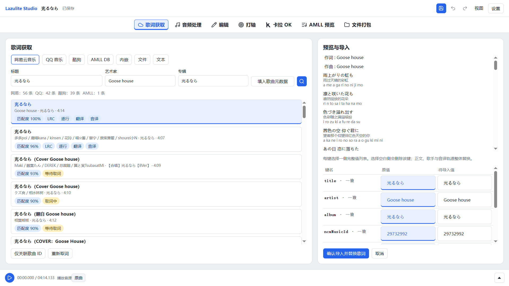
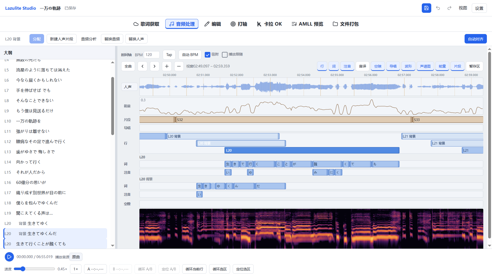
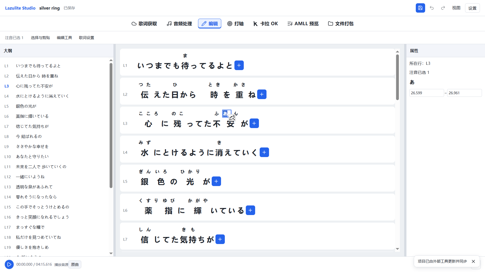
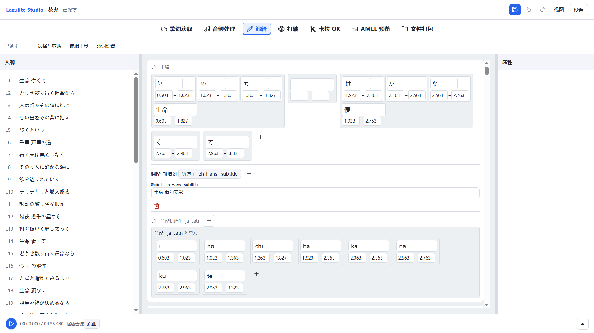
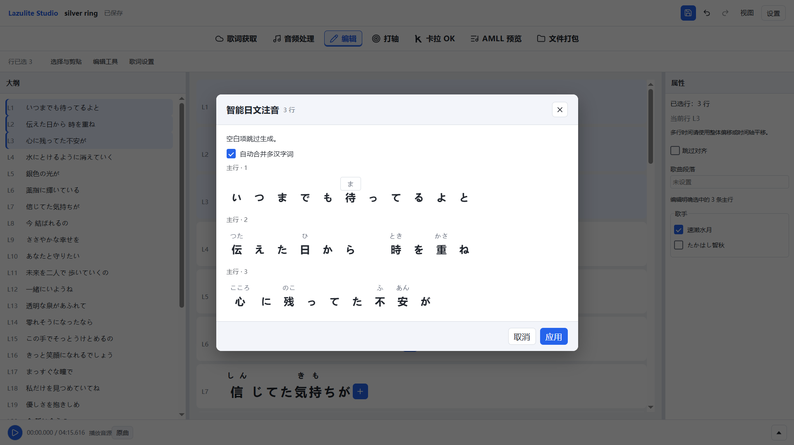
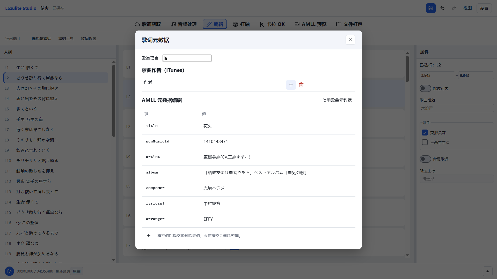
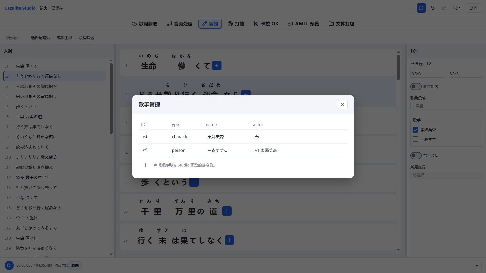
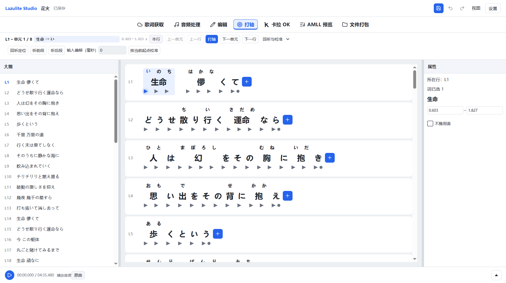
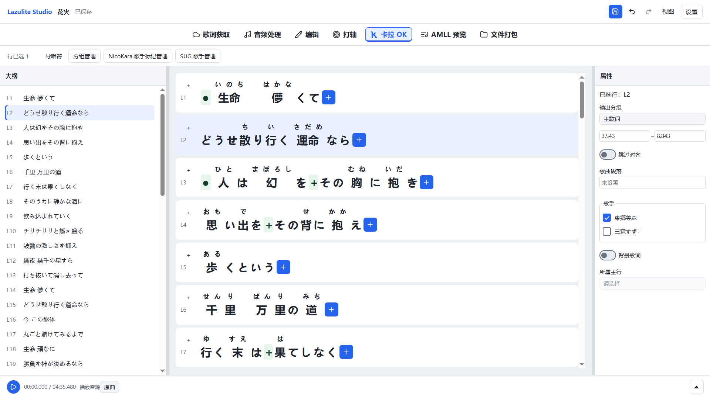
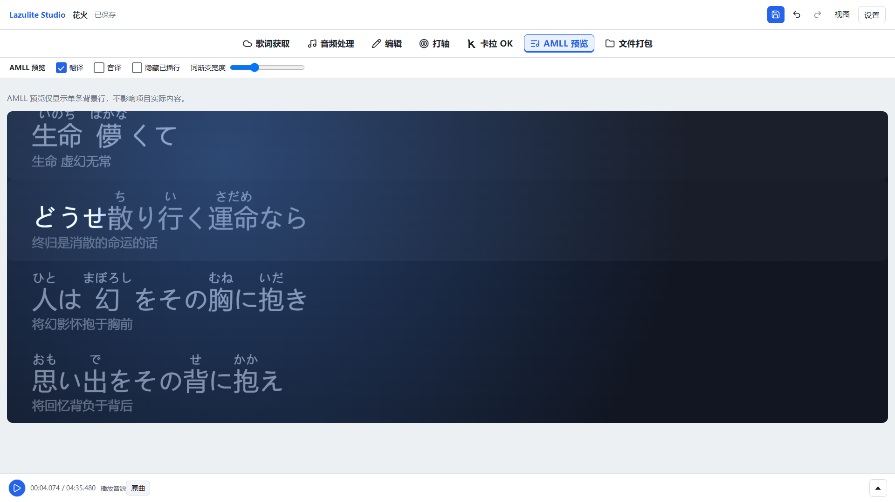
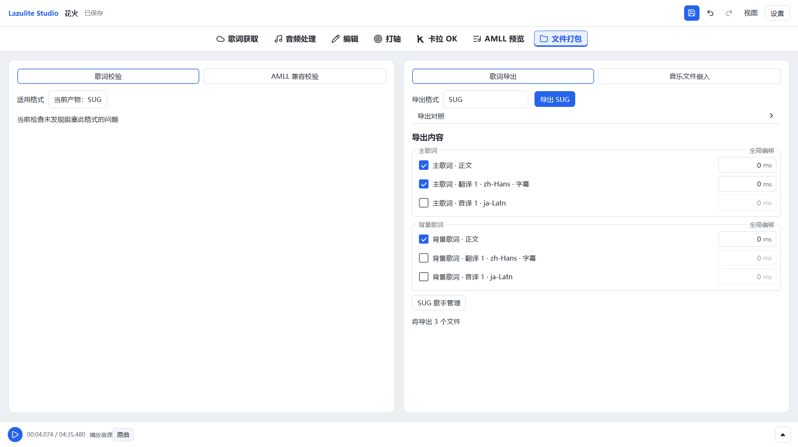
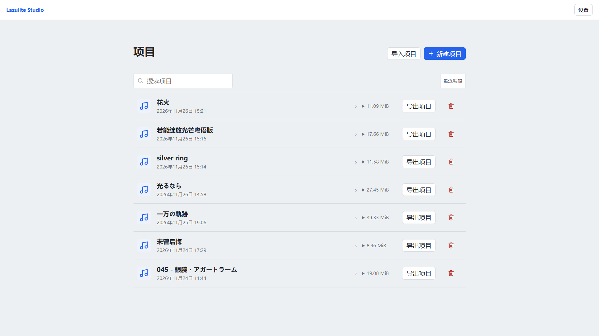

## 从源码运行与部署

如果希望参与开发，或在自己的机器/服务器上从源码运行，可以参考以下基本步骤（要求 Python 3.12+、Node.js 22、pnpm 10 与 `ffmpeg` / `ffprobe`）：

```sh
git clone --recurse-submodules https://github.com/zet-wu/Lazulite-studio.git
cd Lazulite-studio
```

安装后端与前端依赖（macOS / Linux，Windows PowerShell 命令见开发指南）：

```sh
python3 -m venv server/.venv
source server/.venv/bin/activate
python -m pip install -r server/requirements.txt
pnpm --dir frontend install --frozen-lockfile
```

分别在两个终端启动后端和前端：

```sh
# 终端一：启动后端 API
export STUDIO_PASSWORD='replace-with-your-password'
python -m uvicorn server.app:create_app --factory --host 127.0.0.1 --port 8000 --no-proxy-headers --reload --reload-dir server

# 终端二：启动前端开发服务器
pnpm --dir frontend dev --host 127.0.0.1 --port 5173
```

浏览器访问 `http://127.0.0.1:5173`，输入上面设置的密码即可进入工作台。

更多面向开发者和运维的文档：
- [开发与构建指南](docs/development.md)：Windows 命令、可选人声分离/自动对齐环境、MCP 服务构建、便携包与模型资源组装、前端界面调试与翻译维护。
- [生产部署指南](docs/deployment.md)：前端生产构建、单 worker 服务端启动、认证方式与反向代理/HTTPS 配置。
- [项目架构说明](docs/architecture.md)：前后端模块划分、数据模型、编辑事务、媒体处理与测试分层。
