<p align="center">
  
</p>
<h1 align="center">Lazulite Studio</h1>
<p align="center">
  基于 TTML 歌词格式的打轴工具，集丰富的歌词编辑能力、精确打轴、自动化工具为一体。
</p>

---
## 项目简介

本项目受 [Apple Music-like Lyrics TTML Tool](https://github.com/amll-dev/amll-ttml-tool) 、[StrangeUtaGame](https://github.com/karaoke-studio/StrangeUtaGame) 、[MiliKara](https://github.com/BilyHurington/MiliKara) 的启发，旨在提供一个 [AMLL TTML Tool](https://github.com/amll-dev/amll-ttml-tool) 编辑能力的超集、以及主要针对日语歌词的自动化注音、对齐工具。

## 为什么使用TTML
Lazulite Studio 使用 [TTML2](https://www.w3.org/TR/ttml2/) 格式作为内部歌词格式与主要交换格式，这是由于TTML2提供了一个标准且可扩展的歌词字幕模型，能够承载远超原始 LRC 和各类基于 LRC 的扩展格式的数据和结构，包括但不限于：
- 完善的注音（Ruby）结构支持
- 完整的行级、词级、注音（Ruby）级时间
- 稳定的行级 ID，原生能够表达引用、从属等结构
- 背景行指定以及从属主行结构
- 重叠主行、重叠的多个背景（原生支持叠唱、重唱）
- 无上限的、可分别指定语言（BCP 47标准）的独立翻译和音译轨道，支持与正文的从属关系和与正文独立的行级和词级时间
- 原生的演唱者字段，使用稳定的 ID 管理引用
- 精细到词级的演唱者指定

还有一些 Lazulite Studio 暂不提供编辑能力，但TTML能够原生承载的数据，为下游的各类工具提供了极大的扩展性：
- 演唱者字段能够表达虚拟角色与其声优的扮演关系并区分两者
- 颜色、位置、动画等字幕样式
- 更丰富的注音（Ruby）容器与布局，如同时在上下显示注音（Ruby）
- 引用外部图片资源

Lazulite Studio 也支持导入和导出各种格式的歌词，但相比 TTML，这些格式都会不可避免地损失或多或少的信息。

## 功能特性
### 歌词获取
支持从网易、QQ、酷狗、AMLL TTML DB 四个在线源搜索和获取歌词，并能保留其提供的词级时间和音译/翻译行。

### 音频处理
以 [Lazulite](https://github.com/wuchenyanmo/Lazulite) Python 库作为后端，支持人声分离（使用 [Demucs](https://github.com/adefossez/demucs)）、声学分析分片、人声能量与频谱图、日语歌曲自动对齐（默认基于 [NextFire/mms-300m-ForcedAligner-karaoke-ja-Latn](https://huggingface.co/NextFire/mms-300m-ForcedAligner-karaoke-ja-Latn) 模型，该模型使用 CC-BY-NC-SA-4.0 协议，需注意商用限制）等功能。

### 编辑与打轴
简洁而功能强大的编辑与打轴界面，针对日语歌词提供多种自动化工具，涵盖假名注音和罗马字生成。打轴界面支持空拍、单行打轴、定位回听等功能。

### 文件打包
支持向 MP4/M4A 文件的 STPP 歌词轨道写入 TTML 内嵌歌词，支持向 MP3 USLT、FLAC LYRICS、MP4/M4A ©lyr 元数据标签写入普通或扩展 LRC 。

### NicoKaraMaker 3 兼容
支持导出能够输入到 [NicoKaraMaker 3](https://github.com/shinta0806/NicoKaraMaker3) 中的歌词文件，支持写入演唱者标记（借鉴自 [StrangeUtaGame](https://github.com/karaoke-studio/StrangeUtaGame)），支持分组文件输出，支持输出独立的翻译和音译轨道文件。

### [Apple Music Like Lyric](https://github.com/amll-dev/applemusic-like-lyrics) 生态兼容
Lazulite Studio 尽量产出兼容 AMLL 生态的 TTML 歌词，然而，由于 AMLL 对 TTML 的歌词模型做了一定的简化，舍弃了一些本项目认为很有用的数据承载能力，因此 Lazulite Studio 不保证其产物能够完整无损地被 AMLL 生态系列工具和库导入，也不保证其格式完全符合 [AMLL TTML DB](https://github.com/amll-dev/amll-ttml-db) 投稿的要求，若有较高的对 AMLL 兼容的要求，可以调整设置中的“AMLL 兼容设置”项。


## 本地包安装与使用

下载适合系统的 7z 包：
- Windows CPU 版：`LazuliteStudio-windows-x64-cpu.7z`
- Windows cuda 版：`LazuliteStudio-windows-x64-cuda.7z.001` 与 `LazuliteStudio-windows-x64-cuda.7z.002`（需要 Nvidia 显卡及驱动）
- Mac 版：`LazuliteStudio-macos-arm64.7z`

使用支持 7z 的解压工具完整解压后打开其中的文件夹，双击启动入口运行。不要直接在压缩包内运行。
分卷包需下载全部 .7z.001、.7z.002 等文件，放在同一目录，从 .7z.001 开始解压；不要逐卷解压。
- Windows 启动入口：`start.exe`。
- macOS 启动脚本：`start.command`。

保留终端窗口，浏览器会在服务就绪后打开，或者手动访问 http://127.0.0.1:15173 。在终端 Ctrl+C 停止服务。

## 应用截图
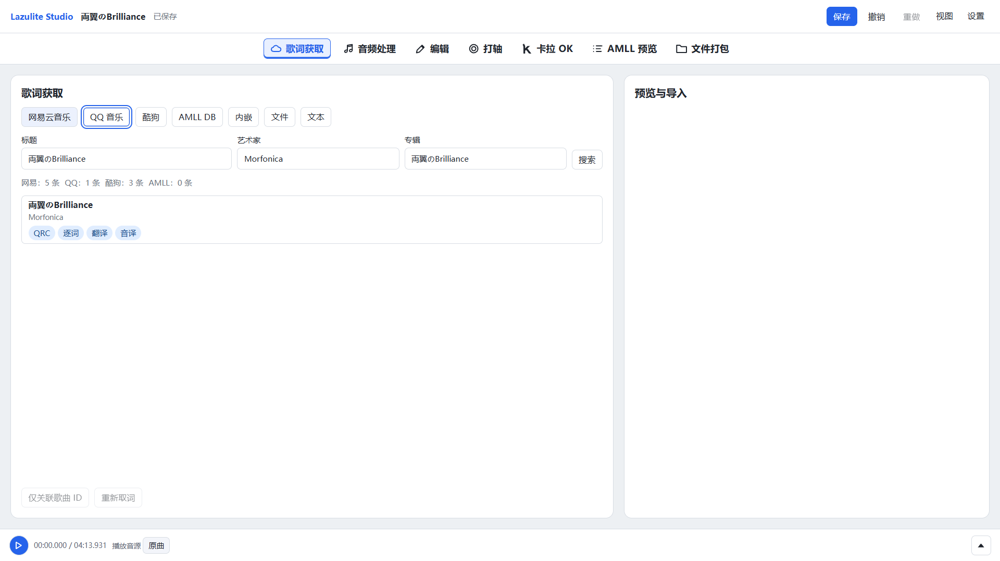
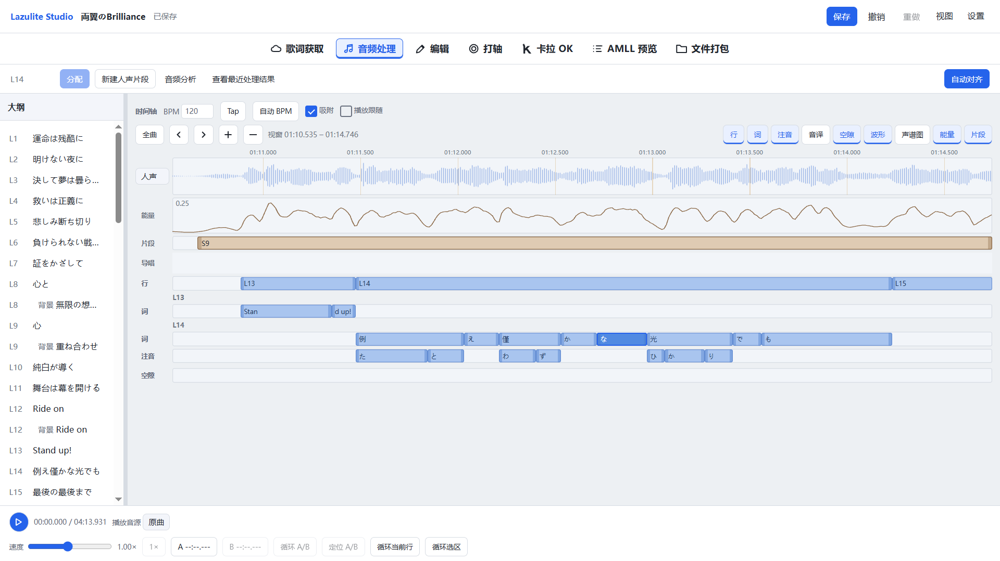
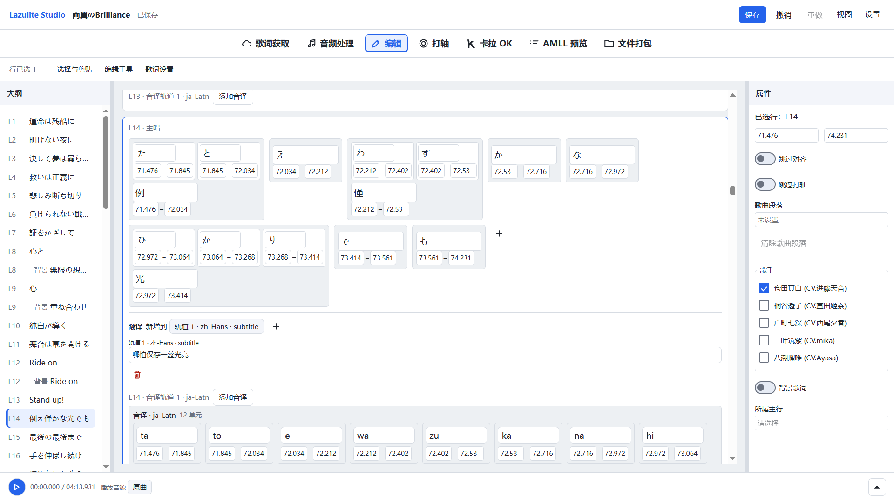
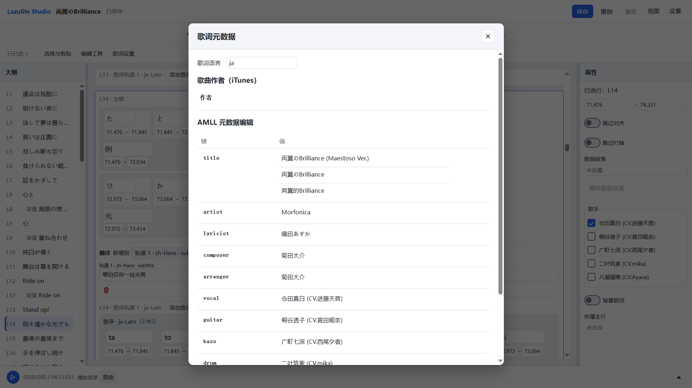
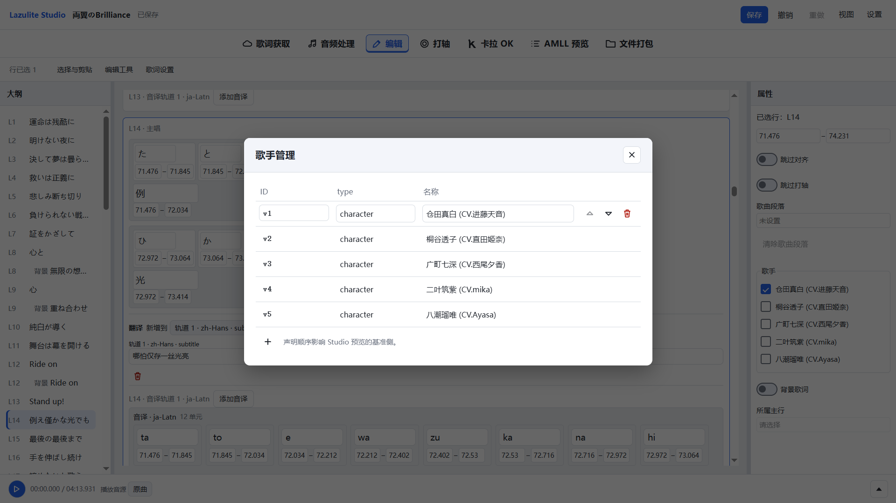
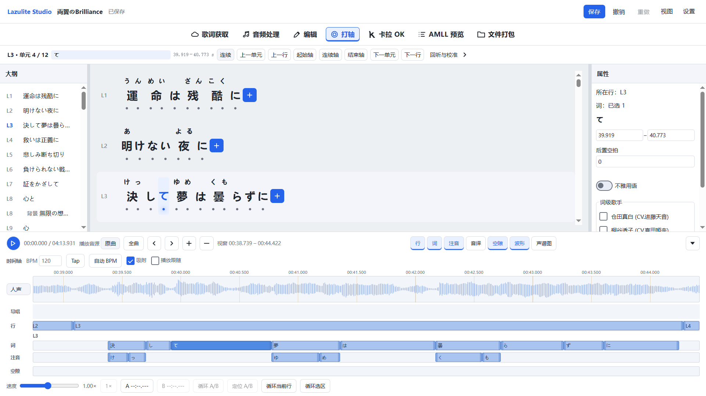
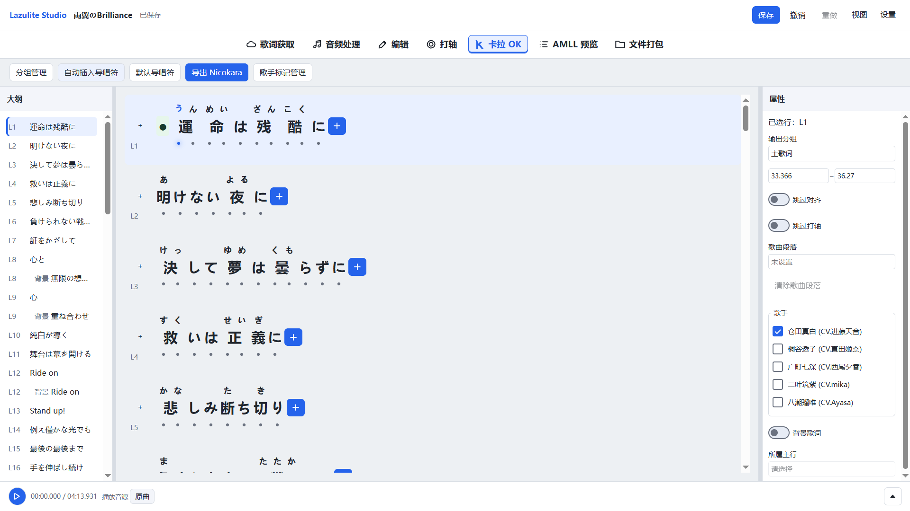
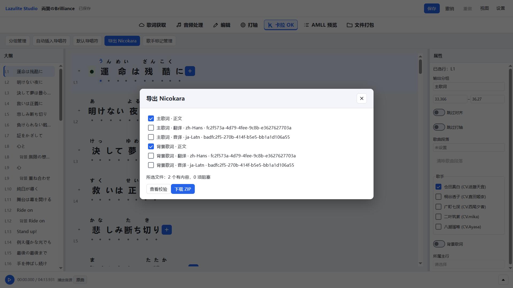
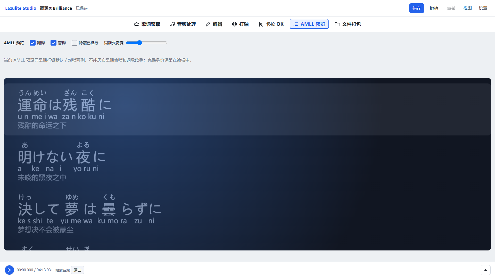
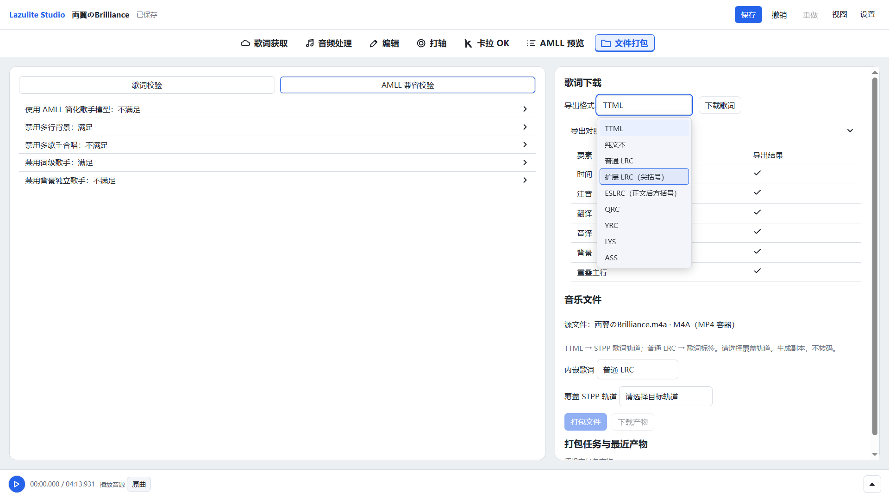
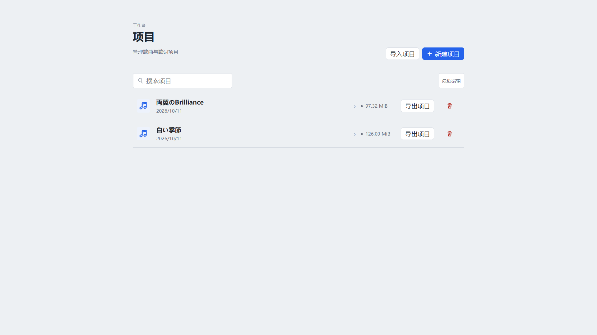

## 开发与生产构建指南

本节适用于希望对 Lazulite 进行开发，或希望在服务器部署并从异机访问的用户，监听外部端口时务必注意鉴权。

### 环境

- Python 3.12 或更高版本：Lazulite 子模块 的 `Requires-Python` 为 `>=3.12`。
- Node.js 22.22.2：与仓库 `.node-version` 一致。
- pnpm 10.30.3：与 `frontend/package.json` 的 `packageManager` 一致。可用 Corepack 执行 `corepack pnpm@10.30.3` 代替下列 `pnpm`。
- FFmpeg 和 FFprobe：可从服务进程的 PATH 调用，负责媒体探测、解码及打包校验。

以下命令从 LazuliteStudio 仓库根目录运行。基础服务从固定的 `vendor/Lazulite` Git 子模块构建安装。首次克隆使用 `git clone --recurse-submodules`；已有检出先运行 `git submodule update --init --recursive`。

### 安装基础依赖

macOS／Linux shell：

```sh
python3 -m venv server/.venv
source server/.venv/bin/activate
python -m pip install -r server/requirements.txt
pnpm --dir frontend install --frozen-lockfile
```

Windows PowerShell：

```powershell
py -3 -m venv server/.venv
& ./server/.venv/Scripts/Activate.ps1
python -m pip install -r server/requirements.txt
pnpm --dir frontend install --frozen-lockfile
```

虚拟环境创建用的 Python 须满足上述版本。PowerShell 若限制激活脚本，可直接用 `./server/.venv/Scripts/python.exe` 替代 `python` 执行后续命令。

基础依赖包含 API、歌词获取、日文读音及媒体处理所需的 Python 库。JmdictFurigana 数据随仓库交付，服务读取固定资源。人声分离和自动对齐使用下文可选运行时。

### 开发运行

终端一在仓库根目录激活虚拟环境，配置浏览器来源与登录密码，启动服务端。

macOS／Linux：

```sh
export STUDIO_ORIGIN='http://127.0.0.1:5173'
export STUDIO_PASSWORD='replace-with-your-password'
python -m uvicorn server.app:create_app --factory --host 127.0.0.1 --port 8000 --reload --reload-dir server
```

Windows PowerShell：

```powershell
$env:STUDIO_ORIGIN='http://127.0.0.1:5173'
$env:STUDIO_PASSWORD='replace-with-your-password'
python -m uvicorn server.app:create_app --factory --host 127.0.0.1 --port 8000 --reload --reload-dir server
```

终端二在仓库根目录启动前端：

```sh
pnpm --dir frontend dev
```

浏览器访问 `http://127.0.0.1:5173`，输入配置的密码。Vite 将 `/api` 代理至 `http://127.0.0.1:8000`。API 端口变化时，在启动前端的终端设置 `STUDIO_API_TARGET`，例如 `http://127.0.0.1:8100`。浏览器地址变化时，修改 API 终端的 `STUDIO_ORIGIN` 并重启服务。

`STUDIO_ORIGIN` 为一个完整 HTTP(S) 来源，由协议、主机和可选端口构成；例如 `http://127.0.0.1:15173`。SSH 转发时填写浏览器实际访问的来源。`localhost` 与 `127.0.0.1` 是不同来源。

仅调试前端界面可运行 `pnpm --dir frontend dev:mock`，它在开发环境启动 MSW 模拟 API。

### 生产构建与运行

```sh
pnpm --dir frontend build
```

产物位于 `frontend/dist`。配置 Web 服务器，以该目录为静态根目录，页面路由回退到 `index.html`，同源 `/api/` 请求转发至 API。API 在已激活虚拟环境的仓库根目录运行：

```sh
python -m uvicorn server.app:create_app --factory --host 127.0.0.1 --port 8000 --workers 1
```

服务继承进程环境中的 `STUDIO_PASSWORD`、`STUDIO_ORIGIN` 和可选 `STUDIO_DATA_DIR`。`STUDIO_ORIGIN` 填写最终浏览器访问来源。任务队列、文件切换及下载锁由 API 进程管理，因此单个数据目录使用一个 API worker，由操作系统服务管理器维持进程生命周期。

Web 服务器需要以下配置：

| 项目 | 配置要求 |
| --- | --- |
| 页面 | 静态文件及 SPA `index.html` 回退 |
| API | 保留 `/api/` 前缀转发至 Uvicorn |
| Cookie／请求头 | 透传 cookie、Origin、CSRF、Range 及条件请求头 |
| SSE | 关闭事件流缓冲，设置适合长连接的超时 |
| 上传 | 代理请求上限与产品接口协调：音频上传 500 MiB；工程包可含至多 2 GiB 源音频及受限快照 |
| 超时 | 允许上传后的媒体探测／代理生成和较大工程包传输完成 |

生产静态站点使用编译后的文件，`vite preview` 用于本机构建预览。前端 API 使用相对路径，同源代理是部署组成部分。

### 可选人声与自动对齐

人声分离：

```sh
python -m pip install -r server/requirements-vocal.txt
```

配置 `STUDIO_VOCAL_MODEL`（默认 `htdemucs`）和 `STUDIO_VOCAL_DEVICE`（默认 `cpu`）。Demucs 使用 Torch 模型缓存，首次获取权重需要网络；`TORCH_HOME` 可配置缓存目录。

自动对齐：

```sh
python -m pip install -r server/requirements-alignment.txt
```

该文件包含人声依赖并引用 `constraints-alignment.txt` 的 Linux CUDA 设备栈约束。Windows/macOS 的 Torch／torchaudio 安装需选用相容的平台构建；此处是当前仓库安装入口，目标平台完整依赖组合仍需发布验证，不能据 Linux 环境断言安装通过。

准备本地 C2C 对齐模型目录，包含 `config.json`、`processor_config.json`、`vocab.json`、`model.safetensors` 等模型资源，设置 `STUDIO_NEXTFIRE_PATH` 为目录绝对路径。`STUDIO_ALIGNMENT_DEVICE` 使用 `cpu` 或 `cuda`，默认 `cpu`；自动对齐首次准备人声使用 `htdemucs` 和 `STUDIO_VOCAL_DEVICE`。设置页显示当前能力和缺失原因。

## 便携入口与原生依赖准备

完整目录布局为 `app/`、`runtime/python/`、`runtime/ffmpeg/`、`models/`、`manifest.json`；运行后创建 `data/` 和 `logs/`。启动模板在 `packaging/launchers`，生产入口为 `server.portable`。源代码仓库本身不是已组装的便携包。

原生构建机使用 CPython 3.12，按平台运行 `python packaging/resolve.py --target windows-x64-cpu|windows-x64-cuda|macos-arm64 --output <空目录>`（target 选择其中一项）。此入口生成本次解析的版本清单与 wheelhouse；只在最终随包解释器中安装和检查一次。外部固定下载保留来源摘要验证，本地产生的 wheel 不再自算摘要后反复验证。固定来源在 `packaging/runtime-manifest.json` 和 `packaging/models.json`。

在对应 Windows x64／Mac arm64 构建机，使用构建 Python 3.12.10 及清单指定版本的 Node 和 pnpm，运行：

```sh
python -m pip install pefile==2024.8.26
python packaging/build.py --target windows-x64-cpu --output /path/outside/repo/portable
```

构建解释器固定为 `build_python_version`（3.12.10，来自 setup-python 支持矩阵）；随包解释器独立固定为 `python_version`（PBS 3.12.15）。两者共用 CPython 3.12 ABI，随包解释器仍须独立执行安装和冒烟检查。

`target` 可选 `windows-x64-cpu`、`windows-x64-cuda`、`macos-arm64`；输出必须为仓库外的空目录，输入检出必须干净。构建入口解析依赖、构建前端、组装独立运行时和本地模型，执行一次 `pip check`、原生架构／动态依赖审计、核心模块／词典／媒体及真实启动退出冒烟，然后清理冒烟生成的数据并压缩。不在打包时运行模型推理、服务安全回归或辅助测试集，不重新解包、不扫描全目录哈希。`artifacts/` 包含 7z 包，按 1900 MiB 分卷；只有一卷时命名 `.7z`，多卷为 `.7z.001`、`.7z.002` 等。所有分卷放在同一目录，从 `.001` 整体解压，不能分别解压。LZMA2 使用 64 MiB 字典和 256 MiB 固实块；构建工具由 `packaging/setup_7zip.py` 固定到官方 7-Zip 26.04。Actions 逐文件原样上传，不添加外层 ZIP。

顶层目录 `LazuliteStudio-<target>` 不含提交哈希；Windows 入口为原生 `start.exe`（构建时使用 MSVC，静态链接运行库），Mac 为 `start.command`。Windows 入口不运行批处理，Ctrl+C／Ctrl+Break 交给 Python 服务处理，等待任务清理并正常退出，不显示批处理 Y/N 提示；旧控制台快速编辑模式在运行期间关闭，退出后恢复。Windows Job Object 负责入口异常结束时的子进程回收。正常关闭信号不由 Uvicorn 再次抛出，重复信号不会跳过清理。构建冒烟只启动一次，通过独立控制台发送 Ctrl+C，并检查正常退出。

包内 `USAGE.txt` 从 `packaging/USAGE.txt` 原样复制。用户包不包含 `files.json` 或 `SHA256SUMS`；诊断只记录版本、实际检查项、产物名称和大小，不生成全文件或归档摘要。下载来源摘要由下载层一次验证；Actions／Release 的传输摘要由 GitHub 提供。构建失败会清除未完成的压缩产物。

GitHub Actions 的 **Build portable previews** 支持手动选择一个目标或全部目标，也作为 Release 的复用构建入口。**Prepare release draft** 仅手动启动，输入新版本号或已有标签；已有 Git 标签使用标签提交，新标签使用启动 Action 时所选分支的提交。三平台全部构建完成后，创建或复用该版本的 Release 草稿、上传 7z 附件，并保持草稿状态，由用户在 GitHub 手动发布。复用草稿保留人工标题和说明，替换本工具管理的旧安装包；其他附件保留。失败可重新运行，无需删除草稿；已公开的 Release 不覆盖。诊断工件不作为 Release 附件，不重新解包或执行测试。模型或依赖升级需要专项行为验证时，可单独运行 `packaging/model_smoke.py`，不作为每次打包步骤。

固定 Lazulite gitlink 已在公开远端可取得，普通递归检出即可构建。

Windows 依赖输入固定了 `msvc-runtime` wheel 的版本与 SHA256，随包提供 VC++ 运行库及许可，嵌套原生工具旁也部署同一组 DLL；不依赖构建机预装的 VC++ 运行库。macOS 审计区分动态库自身的 `LC_ID_DYLIB` 与加载依赖，检查普通、弱链接、重导出、延迟和向上加载依赖。原生审计汇总缺失项，这些检查避免依赖构建机预装库；运行冒烟在压缩前的完整目录执行一次。

开发测试另安装 `python -m pip install -r server/requirements-dev.txt`；pytest／build 不属于发布运行依赖。
