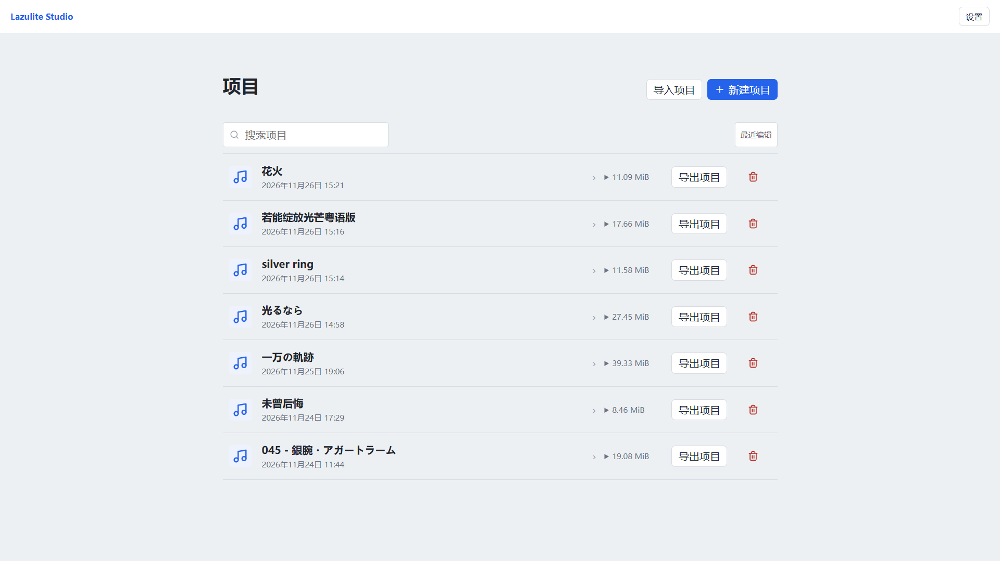
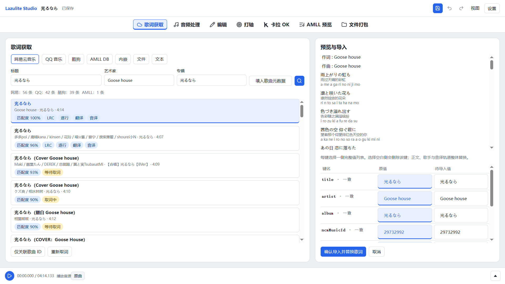
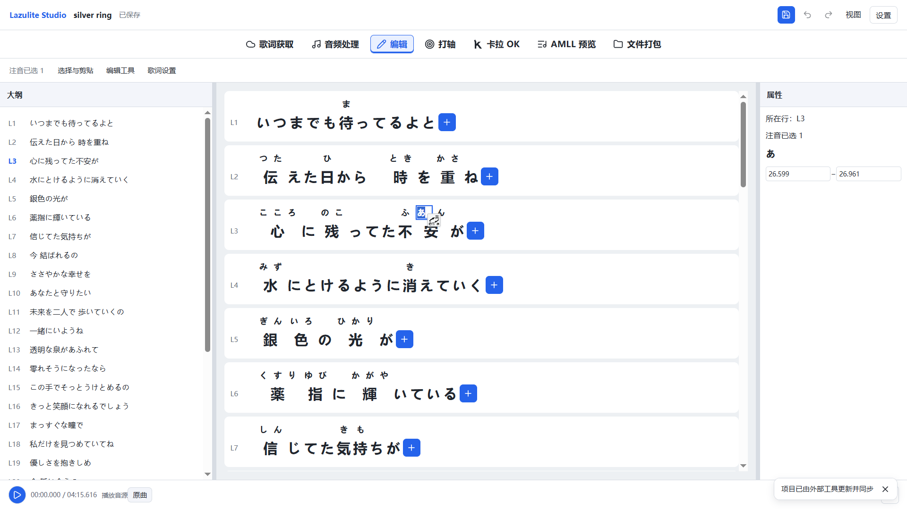
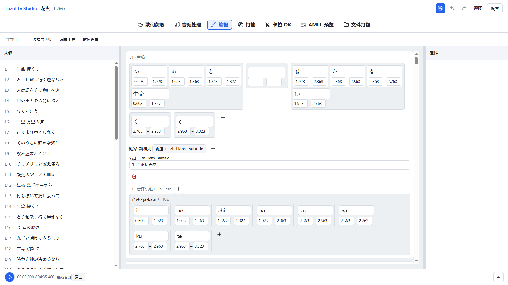
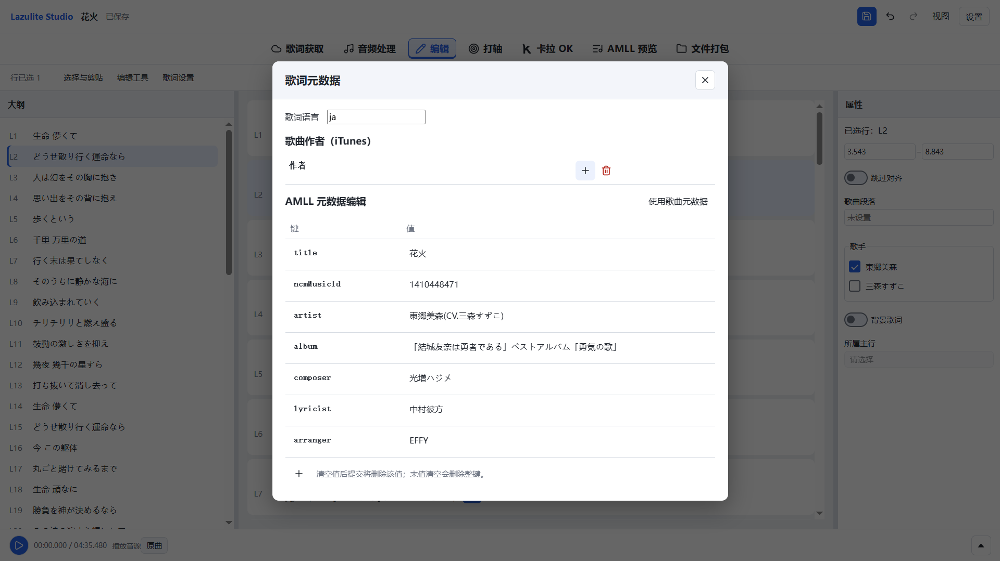
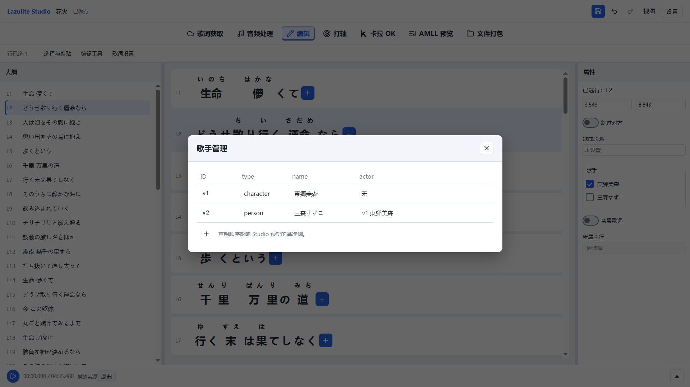
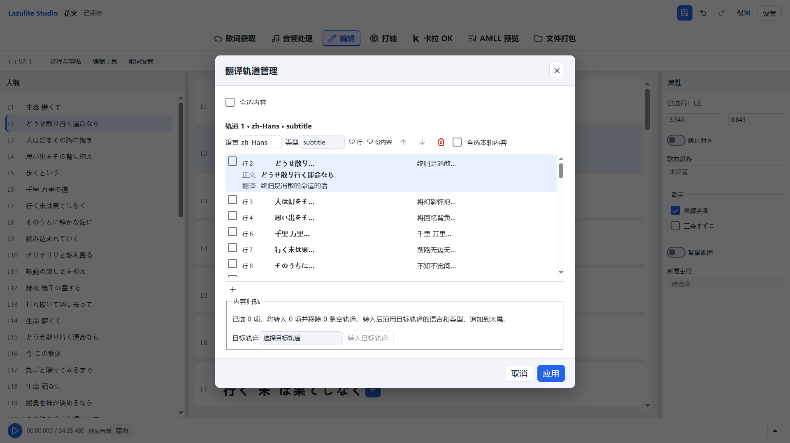
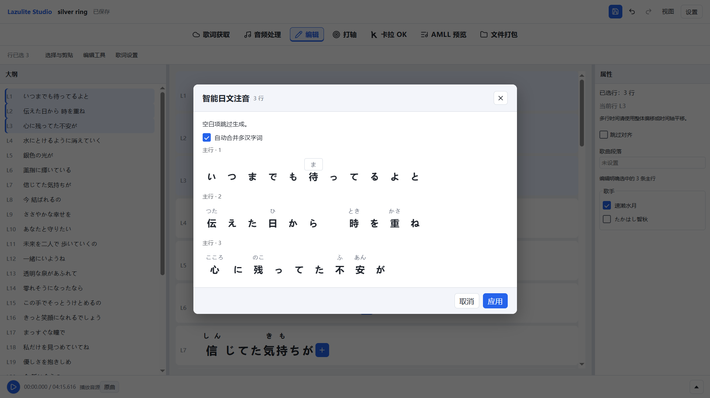
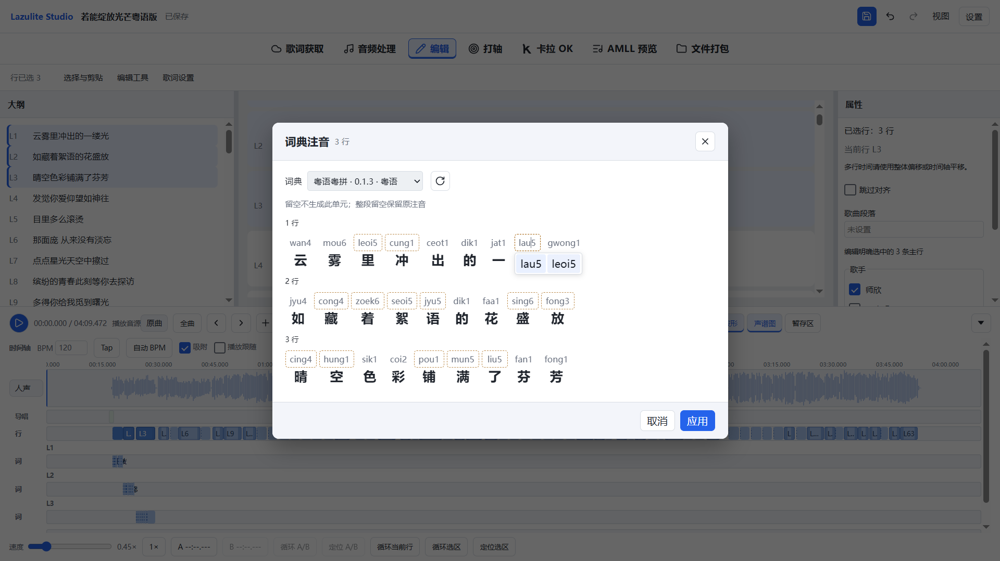
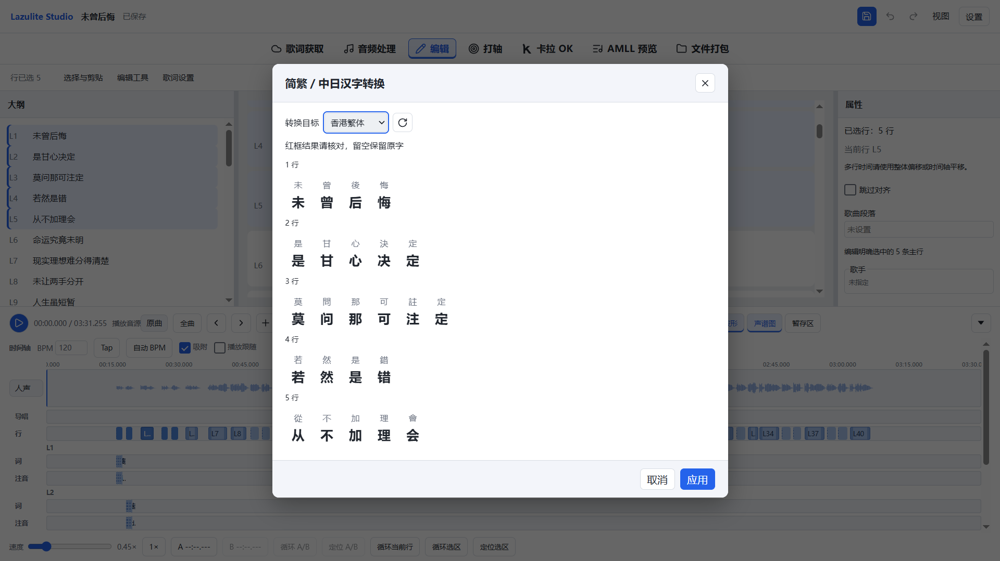

# 1. 歌词获取、编辑与自动注音

本篇介绍项目的创建与备份、从在线源或本地文件获取歌词、简洁与高级编辑视图的操作方式，以及自动注音、音译生成和简繁/日汉转换等自动化编辑工具。

---

## 项目管理与工程归档

启动 Lazulite Studio 后首先进入项目列表页：

- **新建项目**：点击右上角“新建项目”，可选择直接上传音频文件（支持常见音频格式及视频文件，上传视频时会自动提取其中的音轨）创建带音源的项目，也可以先创建无音频的纯歌词项目，后续再通过“替换音频”补充音源。
- **导出与导入项目（`.lazp`）**：列表中每个项目右侧的“导出项目”可将当前歌词草稿、编辑设置与源音频打包为 `.lazp` 归档文件；点击顶部的“导入项目”即可在其他设备或资料库中完整恢复该工程。

---

## 歌词获取

进入工作区后，默认打开**歌词获取**界面：

### 在线搜索与元数据对比
Lazulite Studio 支持从**网易云音乐、QQ 音乐、酷狗、AMLL TTML DB** 四个在线源搜索和获取歌词，并能完整保留在线源提供的词级时间以及音译、翻译行。

- **自动填入搜索条件**：初始化项目或首次上传音频时，会自动读取音频文件的元数据标签（标题、艺术家、专辑）填入搜索框，标题缺失时回退为去掉扩展名的文件名。后续也可以点击“填入歌曲元数据”或手动修改。
- **搜索与匹配度排序**：搜索时会结合标题与艺术家检索候选，并根据标题、艺术家、专辑的匹配程度及歌曲时长计算匹配度分数，在候选卡片上直观标出该条目包含的是逐行 LRC 还是逐字歌词、是否附带翻译与音译。
- **预览与元数据选择**：点击左侧候选后，右侧“预览与导入”会展示歌词正文及元数据对比表。你可以逐键点击选择保留“原值”还是采用“待导入值”（点击空白侧会在提交时删除该键），确认后点击**确认导入并替换歌词**。
- **仅关联歌曲 ID**：如果手头已有歌词，只想按 [AMLL TTML DB](https://github.com/amll-dev/amll-ttml-db) 的规范向 TTML 元数据写入对应平台的歌曲 ID（如 `ncmMusicId`、`qqMusicId` 等，方便后续投稿），选中候选后点击左下角的“仅关联歌曲 ID”即可，不会覆盖现有歌词正文。

### 内嵌歌词、本地文件与纯文本导入
除四个在线源外，切换顶部的来源标签还可以使用以下三种方式：
- **内嵌**：读取当前源音频文件中已内嵌的歌词（如 MP4/M4A 的 STPP 轨道或常见音频元数据标签中的 LRC）。
- **文件**：导入本地歌词文件，支持 `TTML`、各类普通或逐字 `LRC`（含扩展 LRC、ESLRC、QRC、YRC、LYS、KRC）以及单个 **StrangeUtaGame（SUG 0.3.0）** 项目文件。
- **文本**：直接粘贴纯文本或歌词源码解析导入。

---

## 编辑界面

编辑界面支持任意行、词、注音或计时音译/翻译单元的单选、多选（`Ctrl`/`⌘` 加选、`Shift` 连续选择）和拖动排序。通过右上角顶栏的**视图**菜单，可以在“简洁编辑”与“高级编辑”两种显示模式之间切换，并按需开关左侧大纲、右侧属性栏或底部常驻时间轴。

### 简洁编辑与高级编辑

**简洁编辑模式**（默认）采用紧凑的“上方注音、下方正文”两行排版，适合快速通读歌词、调整分词边界与核对注音：

点击选中某个词或注音后，可在右侧**属性**栏直接查看或修改其起止时间、所属歌手与属性开关；双击画布上的词或注音也可原地修改文字。若同时开启了外部 AI / MCP 工具协同修改，右下角浮层会自动提示“项目已由外部工具更新并同步”。

**高级编辑模式**则将每个词、注音以及逐词计时的音译/翻译单元展开为带独立文本与起止时间输入框的卡片，并在行内直接展示所有翻译与音译轨道的编辑区，适合需要对照具体数值精细编辑多轨道内容的场景：

### 常用结构编辑与快捷键
在画布上选中单元后，可通过顶部工具栏（“选择与剪贴”、“编辑工具”）或**右键菜单**执行常见操作：
- **拆分单元（默认快捷键 `K`）**：将选中的词拆分为更细的单元（也可双击词卡片或在词内分词边界处直接点击切分）。
- **合并所选（默认快捷键 `M`）**：将同一行内连续选中的多个词或同一词内连续选中的多个注音合并为一个单元，时间包络会自动合并。
- **拆行与合并行**：在行内指定词处将一行拆为两行，或将连续选中的多行合并为一行。
- **复制与粘贴**：整行复制粘贴以及按住修饰键复制拖动词时，会保留原有的时间轴；单独复制部分词、注音或计时附属单元并粘贴到别处时，会自动清空时间，避免不同位置的时间轴互相冲突。

---

## 歌词设置：元数据、歌手与翻译/音译轨道

点击编辑界面上方工具栏的**歌词设置**，可管理项目的全局结构信息。

### 歌词元数据

- **歌曲语言**：填写正文的语言代码（建议使用 BCP 47 标准，如日语 `ja`、简体中文 `zh-Hans`、粤语 `yue`）。
- **歌曲作者（iTunes）** 与 **AMLL 元数据编辑**：采用统一的键值表格管理标题（`title`）、歌手（`artist`）、专辑（`album`）、作曲（`composer`）、作词（`lyricist`）、编曲（`arranger`）及各平台音乐 ID。点击右上角“使用歌曲元数据”可从源音频标签一键补齐空缺字段。

### 歌手（演唱者）管理

TTML 的歌词模型采用稳定 ID（如 `v1`、`v2`）管理演唱者，并配有自定义的 `name`（显示名称）字段。Lazulite Studio 在属性栏和导出设置中优先展示歌手名称，未填写时回退显示 ID。
- **角色与声优关联（`actor`）**：按照 TTML2 标准，`type` 可设为虚拟角色（`character`）、个人（`person`）或组合（`group`）。当为声优（`person`）指定 `actor` 关联到对应的虚拟角色（如上图 `v2 三森すずこ` 关联 `v1 東郷美森`）时，能够原生表达“由某声优扮演某虚拟角色”的关系。
- **行级与词级歌手**：在右侧属性栏中可为选中的行或词勾选一位或多位合唱歌手。若需要指定**词级歌手**（同一行内不同词由不同歌手演唱），请在右上角**设置 → AMLL 兼容设置**中关闭“禁用词级歌手”（该项为照顾 AMLL 兼容性默认开启）。

### 翻译与音译轨道管理

Lazulite Studio 支持创建任意多条独立的翻译轨道和音译轨道，每条轨道可分别指定语言（如 `zh-Hans`、`ja-Latn`）与类型。在“翻译轨道管理”或“音译轨道管理”窗口中，可以调整轨道顺序、新增或删除轨道，也可以勾选若干行内容通过底部的**内容归轨**批量转移到另一条目标轨道，并自动清理转移后变空的旧轨道。

---

## 自动化编辑与注音工具

点击编辑界面上方工具栏的**编辑工具**，可以使用以下自动化辅助功能。所有生成与转换窗口均提供可编辑预览，确认点击“应用”后作为单次操作提交，可随时按 `Ctrl + Z` 一步撤销。

### 智能日文注音

不依赖音译轨道、Windows 日语语言包或外部大语言模型，直接基于本地 Sudachi 分词与 JmdictFurigana 词典为日文汉字及阿拉伯数字生成细粒度的假名注音：

- 自动将包含多个独立读音的正文词拆分为细粒度单元；勾选**自动合并多汉字词**时，会将需要整体注音的复合词以及“数字 + 日文量词”（含促音、浊音等联合音变）自动合并。
- 预览框中的所有假名输入框均可直接手动修改；若某一项留空，应用时会跳过该词的注音生成。

### 词典注音

使用公开格式的本地词典包为中文、粤语及各类方言歌词自动分词并标注读音。词典的格式规范与更多方言词典下载见 [Lazulite Studio 注音词典仓库](https://github.com/zet-wu/Lazulite-studio-dict)。本地打包版默认内置**普通话汉语拼音**和**粤语粤拼**两个词典，词典仓库还提供 8 种不同地区口音的**潮州话词典**（可在右上角“设置 → 注音与拉丁化”中导入 ZIP 安装）：

- 词典分析会根据词频与单字常用音给出默认读音；遇到多音字或存在多种读音的词条时，对应输入框会以**橙色虚线框**标出。
- 点击或用键盘聚焦到带虚线框的单元时，下方会弹出**候选读音浮层**（支持鼠标直接点选，或用键盘上下方向键、`Enter` 选择、`Esc` 收起），也可直接在框内手动输入修改。

### 生成日文罗马字音译
从正文已有的假名与注音（Ruby）自动生成日语罗马字音译轨道，预览框内可直接修改生成结果：
- 作为助词的 `は`、`へ` 会结合行内分词上下文自动转换为 `wa`、`e`。
- 预览界面默认会高亮 `は`、`へ`、`を` 这三个有特殊读法的假名所对应的罗马字，方便快速扫视确认；可在生成窗口顶部的“高亮假名”中临时增删本次高亮的字符，也可在**设置 → 注音与拉丁化**中修改“音译高亮字符默认值”。

### 从音译生成注音
当在线获取的歌词本身带有**逐词计时的罗马字音译轨道**、但正文缺少假名注音时，可使用此工具通过时间重叠匹配，反向为对应的正文词生成假名注音：
- 生成的假名与正文完全相同时会自动跳过（避免为纯假名正文加上多余注音）。
- 未能通过时间重叠匹配到唯一最佳正文词的音译单元会高亮提示，可在预览窗口中手动指定目标词或跳过。

### 简繁 / 中日汉字转换

基于原生 OpenCC 对选中行或全曲正文执行多目标字形转换（支持简体转台湾正体、香港繁体、日本新字体及反向转换等）：

存在一简对多繁或异体歧义的字会以红框高亮提示核对，可直接点击修改，留空则保留原字。

### 批处理工具（消除词间空隙等）
在“编辑工具 → 批处理”窗口中，可以对全曲或选中行执行批量操作：
- **整体时间偏移**：将选中范围或全曲的时间轴整体提前或延后指定毫秒数。
- **消除词间空隙**：自动检测同一行内相邻读音单元（包括注音与纯正文词）之间的微小时间空隙或轻微重叠，当空隙/重叠短于设定阈值时自动将其闭合（并同步更新父词与父行的时间包络）。默认仅处理中日韩文字读音，也可勾选包含拉丁字母等非中日韩读音（纯空格与标点始终跳过）。窗口会实时显示预计调整的边界数量。
- **批量清理**：支持一键清除选中范围内的注音、时间轴或导唱符。

---

下一篇：[2. 音频处理与自动对齐](2-audio-and-alignment.md)
