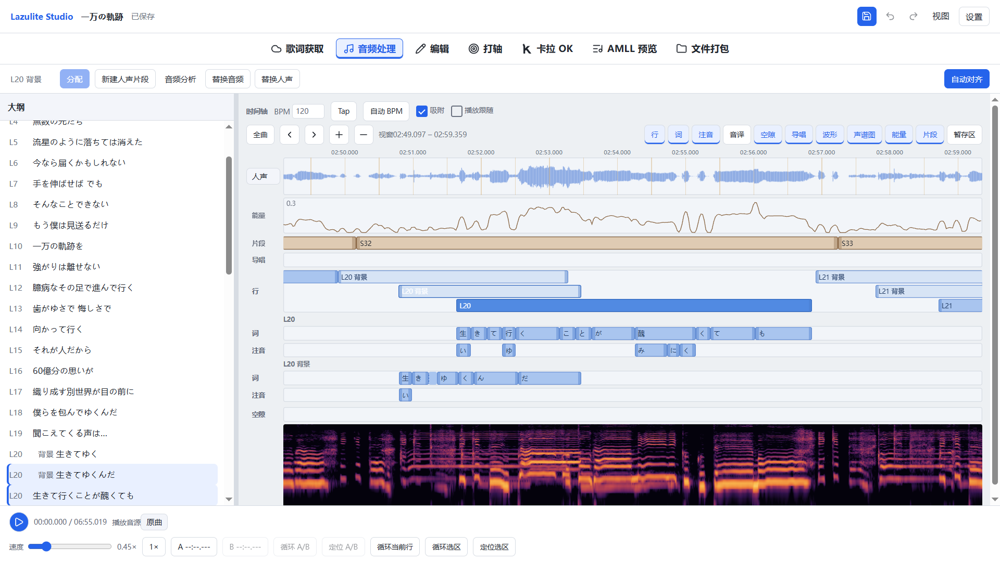
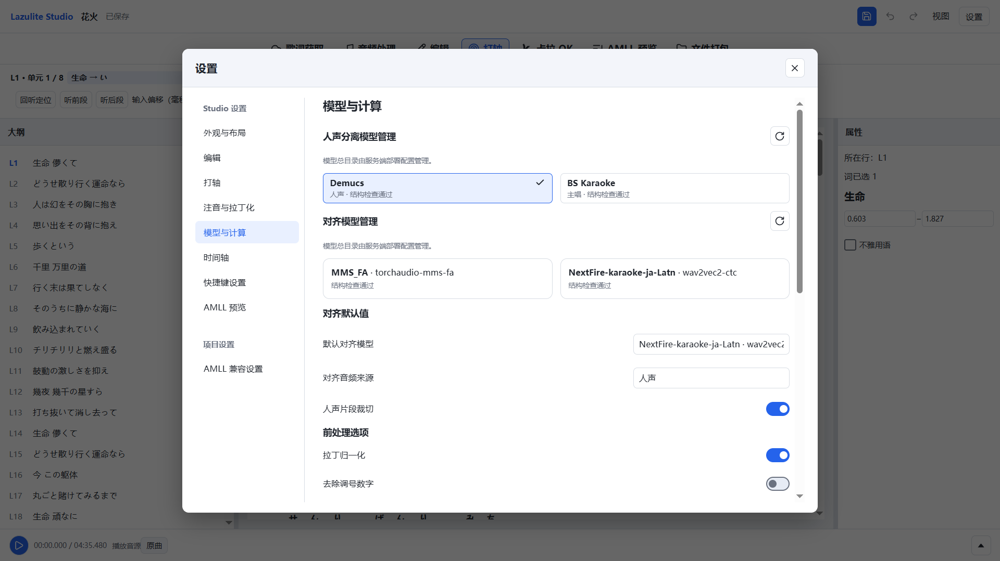
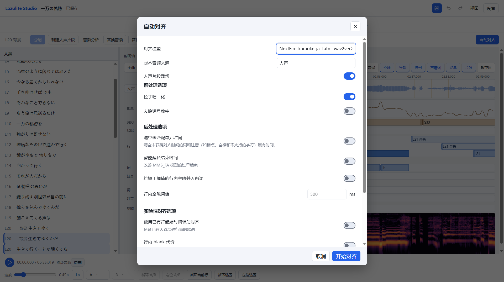

# 2. 音频处理与自动对齐

本篇介绍人声分离模型的选择、人声片段与声谱图的查看方式、自动对齐模型及各项前后处理参数的配置，以及如何利用**跨模型局部自动对齐**进一步提高时间轴精度。

---

## 人声分离与声学分析

切换到**音频处理**界面后，主工作区会展示完整的多轨时间轴（包括人声/原曲波形、人声能量曲线、人声片段、导唱轨、行/词/注音轨、空隙轨以及底部的对数频率声谱图）：

### 人声分离模型选择
在右上角**设置 → 模型与计算**中，可以查看和切换当前使用的人声分离模型：

Lazulite Studio 支持两档本地人声分离模型：
- **[Demucs](https://github.com/adefossez/demucs)（默认内置）**：推理速度极快（GPU 下分离一首歌仅需数秒，CPU 下也可在较短时间内完成），在绝大多数常规录音室歌曲上已经能够满足自动对齐和声谱观察的需要。
- **[BS Karaoke](https://huggingface.co/becruily/bs-roformer-karaoke)（可选安装）**：专门针对卡拉 OK 主唱提取训练的模型，能够同时剥离伴奏以及背景人声、伴唱和声。对于背景嘈杂、主唱与伴唱严重重叠的歌曲（尤其是合唱段落或 Live 版录音），或者希望在声谱图上获得更干净的主唱谐波纹理时，推荐切换为 `BS Karaoke`。需要注意的是，该模型计算量较大（耗时约为 Demucs 的 15–20 倍），**不建议在纯 CPU 推理下使用**。

切换人声分离模型只影响后续新发起的分离任务；项目已分离出的人声结果会继续保留并复用，如需用新模型重算，可在音频处理界面点击“音频分析”重新发起人声分离。此外，如果你已经通过其他工具准备好了伴奏分离后的干声文件，也可以直接点击顶部工具栏的**替换人声**上传外部人声（系统会自动通过波形互相关估算其与原曲的偏移并对齐）。

### 人声片段（`core`）与手动分配
人声分离完成后，声学分析算法会根据人声能量自动剔除前奏、间奏、尾奏等长静音段，将整首歌划分为若干个人声活跃区间（在时间轴上显示为**片段**轨，如 `S32`、`S33`）：
- **为什么需要人声片段**：如果把包含长间奏的整首音频直接送入 CTC 对齐模型，间奏中的器乐残余噪音很容易吸引词首或词尾滑移。先切出人声活跃片段并拼接后送入对齐模型，可将双端 100 ms 命中率显著提升 3–10 个百分点。
- **手动微调片段**：在极少数前奏或间奏有人声哼唱（如无词吟唱）造成干扰时，你可以在片段轨上直接拖动片段左右边界、点击工具栏的“新建人声片段”或选中干扰片段按 `Delete` 删除，以在对齐前排除干扰（绝大多数情况下保持自动生成的片段即可，无需手动调整）。
- **快速分配行时间**：在左侧大纲或画布选中某一行歌词，再在时间轴上点击某个人声片段，点击左上角的**分配**按钮，即可将该行的起止时间直接对齐到该片段的区间。

---

## 自动对齐

### 对齐模型管理
本地包提供两个基于 [facebook/mms-300m](https://huggingface.co/facebook/mms-300m) 的 Wav2Vec CTC 对齐模型（符合相同格式与输入输出约定的自定义模型也可放入模型目录，默认位于程序根目录下的 `models/`，可在**设置 → 模型与计算 → 对齐模型管理**中修改目录并点击刷新扫描）：

- **[NextFire/mms-300m-ForcedAligner-karaoke-ja-Latn](https://huggingface.co/NextFire/mms-300m-ForcedAligner-karaoke-ja-Latn)**：使用日语歌唱音频微调的专用模型，在日语歌曲上具备极高的起止定位精度，是**日语歌曲首轮对齐的首选模型**。其少量误差主要集中在超长拖音或一行内连续出现相同元音时的局部挤缩。
- **[MMS_FA](https://docs.pytorch.org/audio/main/generated/torchaudio.pipelines.MMS_FA.html)**：通用的跨语言对齐模型，适用于**国语、粤语、英语、潮州话等非日语歌曲及多语种混合歌曲**，也可用于日语歌曲的局部重算修补。原始 `MMS_FA` 的起始时间定位很准，但结束时间往往明显偏早；因此在选用 `MMS_FA` 时，**强烈建议开启后处理中的“智能延长结束时间”选项**，利用细粒度人声静音搜索和后一单元的起点校正尾音，开启后即可在各语种上达到接近 `NextFire-karaoke-ja-Latn` 的效果。

---

### Studio 对齐流程及建议

点击音频处理界面右上角的**自动对齐**按钮，即可打开对齐配置窗口（常用默认参数也可在**设置 → 模型与计算 → 对齐默认值**中统一预设）：

1. **前置准备（分词与注音）**：
   - 送入对齐模型的文本是歌词的**注音**（当某个词有注音时优先使用注音，没有注音时才使用正文词本身），**不会使用音译轨道**。
   - 鉴于中文、日语及各类方言广泛存在多音字与特殊读法，**强烈建议在运行自动对齐前，先在编辑界面使用“智能日文注音”或“词典注音”为所有汉字和数字标注准确的注音**（日语使用假名或罗马字，汉语与方言使用拼音/粤拼等拉丁字母方案）。
   - 如果歌词中包含歌曲信息行、纯符号行或不需要自动打轴的行，可以在编辑界面选中这些行，在右侧属性栏勾选**跳过对齐**。
2. **音频来源与片段裁切**：
   - **对齐音频来源**：默认选择**人声**（若项目尚未执行人声分离，启动对齐前会自动先运行人声分离和声学分析）；在清唱或纯人声录音上也可切换为**原曲**。
   - **人声片段裁切**：默认开启，即仅将时间轴上“片段”轨覆盖的人声活跃区间拼接后送入模型。若你在“片段”轨上手动删改了片段，对齐会严格按当前片段范围裁切。
3. **运行与结果应用**：
   - 点击“开始对齐”后，后台子进程会执行模型推理（右下角任务浮层可随时查看进度或取消；若页面刷新，完成后也会在右下角浮层提示恢复并应用结果）。
   - 对齐结果写入文档属于单次原子编辑事务，如对结果不满意，随时可按 `Ctrl + Z` 撤销。若某个字符（如标点符号、空格或未拉丁化的特殊符号）无法转换为对齐模型支持的字母，该单元会被自动跳过，不影响其余单元的对齐。

---

### 对齐相关选项说明

- **前处理选项**（仅影响送入对齐模型的内部字母序列，**不会修改歌词原文或注音**）：
  - **拉丁归一化**：本地包提供的两个模型均只接受英文字母输入，因此**需要保持开启**。开启后会将送入模型的假名或汉字自动转写为拉丁字母，而原本已经是拉丁字母的内容（如英文歌词、词典注音生成的拼音/粤拼）会保持原样。
  - **去除调号数字**：专为粤拼等使用“字母 + 末尾数字调号/五度标调”的方言拼音方案设计。在给词典注音后的中文或方言歌曲对齐时**建议开启**，前处理会自动剥离每个读音末尾的连续数字（例如 `soeng1` → `soeng`），避免调号干扰声学匹配；若日语歌词正文中包含未注音的阿拉伯数字，则应先为其标注假名注音，或关闭此项以免数字正文被剥离。
- **后处理选项**（影响最终写入歌词的时间轴）：
  - **清空未匹配单元时间**：开启后，在写入对齐结果时会一并清空那些未送入模型或未获得匹配结果的单元（如标点符号、空格）原有的旧时间。
  - **智能延长结束时间**：开启后，会结合后一个有效单元的起始时间、人声片段分界点以及借鉴自 [FA-Kara](https://github.com/moriwx/FA-Kara) 的细粒度静音检测来延长每个单元的结束时间。**使用 `MMS_FA` 模型时请务必开启**；使用 `NextFire-karaoke-ja-Latn` 时一般无需开启。
  - **将短于阈值的行内空隙并入前词**：开启后，会自动延长前一个单元的结束时间，消除同一行内所有短于设定阈值（如 `500 ms`）的微小空隙。若与“智能延长结束时间”同时开启，会在智能延长之后继续执行此合并。
- **实验性对齐选项**：包含借鉴自 [MiliKara](https://github.com/BilyHurington/MiliKara) 的四项软代价与辅助对齐开关。在 20 首日语测试集上的消融实验表明，这些附加项对实际命中率提升微乎其微，部分选项甚至可能引起相邻同音字滑移，默认保持关闭即可，有特殊需要时可自行评估开启。

---

## 局部自动对齐与跨模型异常行重算

除了对整首歌执行全局自动对齐外，Lazulite Studio 还支持对**选中的单行、连续多行或若干词**执行**局部自动对齐**。

### 适用场景：跨模型修补 `NextFire` 的局部失准
在日语歌曲上，`NextFire-karaoke-ja-Latn` 虽然整体准确率最高，但偶尔会在包含超长拖音或连续相同元音的行内出现“局部挤缩”——表现为把某几个正常发音的假名挤成不到 `30–40 ms` 的极短条块，而把旁边同元音的另一个假名拉得过长。

如果用同一个 `NextFire` 模型对这些异常行反复重算，结果往往不会改善；但**换用 `MMS_FA` 并开启“智能延长结束时间”**对这些异常行做局部重算，就能很好地利用 `MMS_FA` 稳定的音节起点定位能力修复挤缩。实验显示，在首轮 `NextFire` 对齐后，仅筛选出不到 10% 的极短音节/同元音失衡异常行换用 `MMS_FA + 智能延长` 局部重算，就能将日语测试集的双端 100 ms 命中率从 84.5%–86.6% 进一步推高至 **85.9%–88.1%**。

### 操作步骤
1. 首轮全曲对齐后，在时间轴（可借助**空隙轨**观察异常留白，或在词/注音轨上观察极窄条块）或编辑界面中找到存在挤缩偏差的行（要求该行或其所在连续范围已有大致准确的起止时间范围）。
2. 在编辑画布或时间轴上选中该行（或行内需要重算的连续几个词），点击**鼠标右键 → 局部自动对齐**。
3. 在弹出的对齐窗口中，将“对齐模型”切换为 **`MMS_FA`**，并开启后处理中的**智能延长结束时间**，点击“开始对齐”。
4. 局部对齐只会截取所选范围对应的时间包络窗口送入模型，并只更新你选中的行或词及其父级时间包络，不会触碰其他已经对齐好的歌词行。

> **提示**：局部对齐每次截取的是所选目标从最小起点到最大终点的连续音频窗口。如果需要重算不相邻的多行（例如第 3 行和第 15 行），请分别对每一行（或每一段连续相邻行）单独执行局部对齐，不要跨行多选非连续范围一次性提交。

---

下一篇：[3. 手动打轴与时间轴微调](3-sync-and-timeline.md)
