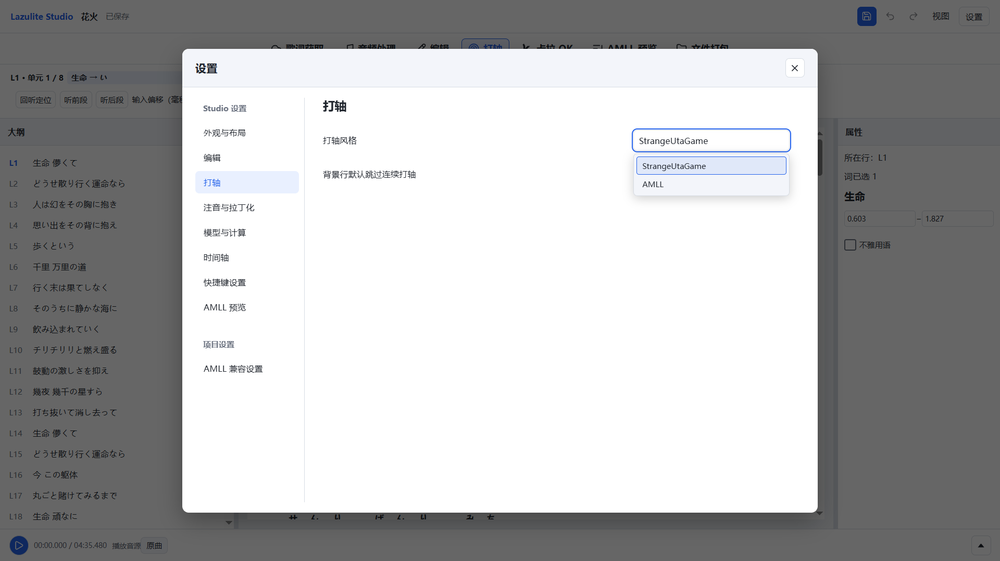
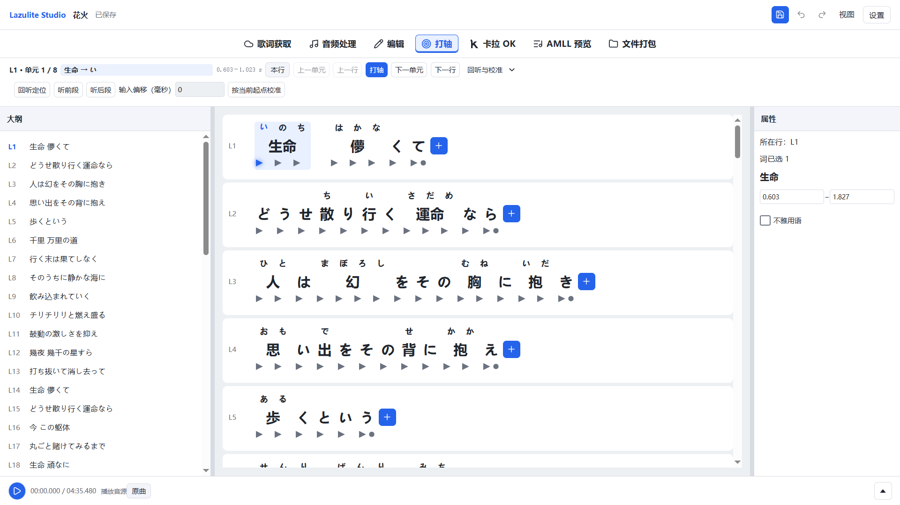
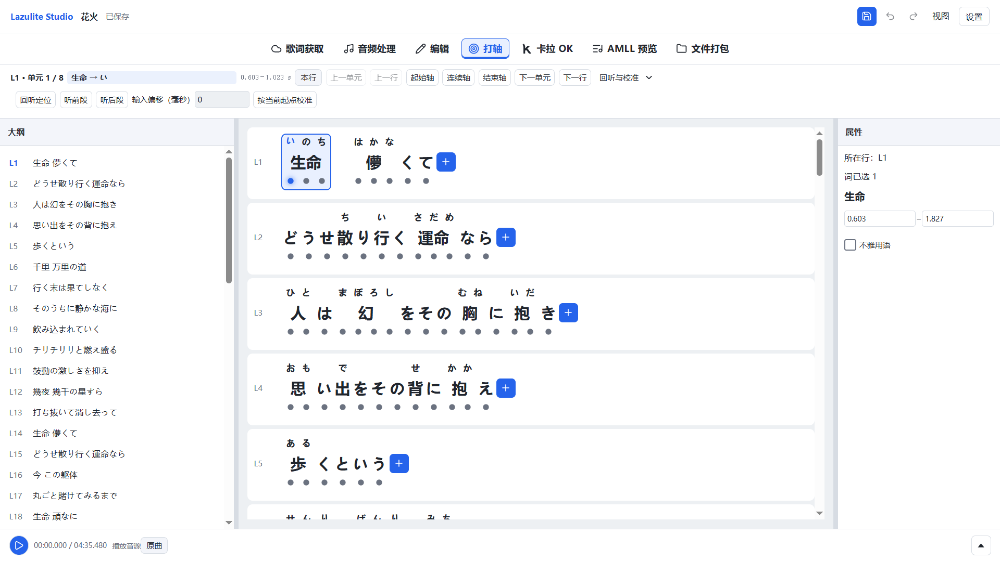
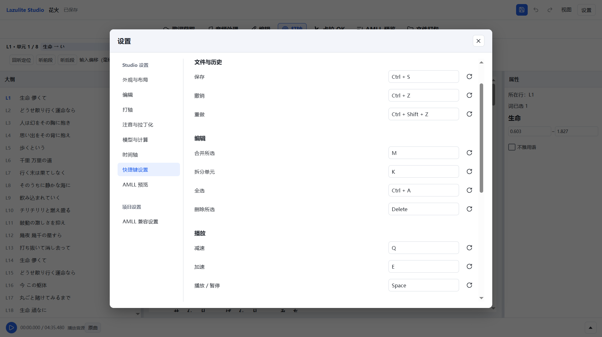
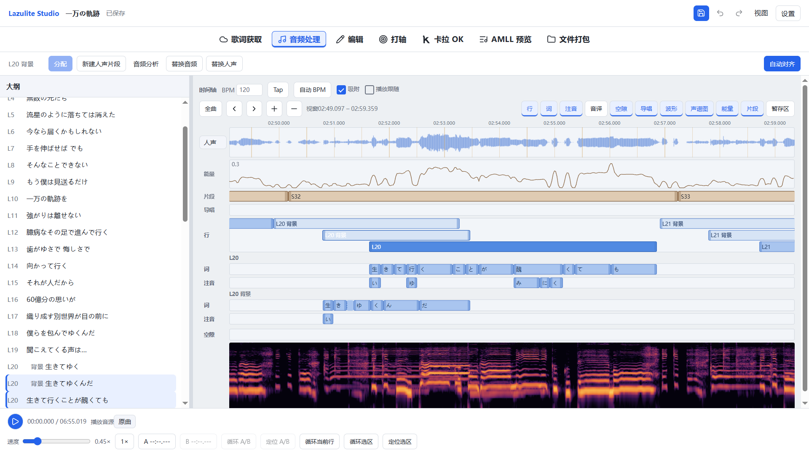

# 3. 手动打轴与时间轴微调

无论是从零开始纯手动打轴，还是在自动对齐之后针对个别尾音、转音进行精调，Lazulite Studio 都提供了完整的**打轴界面**与**声谱时间轴**交互。

---

## 打轴界面与两种打轴风格

切换到**打轴**界面后，当前打轴游标所在的词或注音会在画布上高亮显示。在打轴界面同样可以通过双击单元直接修改正文与注音，并拥有与编辑界面一致的右键菜单，还会额外显示每个读音单元下方的**打轴节奏标记**。

在右上角**设置 → 打轴**中，可以根据个人习惯在 **StrangeUtaGame**（默认）与 **AMLL** 两种打轴风格之间切换：

### 1. StrangeUtaGame（SUG）风格（默认）

SUG 风格参考了 [StrangeUtaGame](https://github.com/karaoke-studio/StrangeUtaGame) 的标记呈现与单键打轴交互，工具栏中央仅保留一个主**打轴**按钮（默认对应键盘 `D` 键）：

- **节奏点与终止点标记**：每个读音单元下方显示三角形的**起始/词内节奏点**（`▶`）；当某个单元之后存在停顿（默认在每行最后一个单元末尾自动设置，也可通过右键菜单在行内任意单元后手动开启或关闭）时，该单元末尾会多出一个圆形的**终止点**（`●`）。
- **单键打轴逻辑**：
  - 每次**按下**打轴键（默认 `D`），就会把当前播放时间记录到当前单元的起点（或推进词内的下一个节奏点），已打过的标记会亮起。
  - 当推进到带有圆形**终止点（`●`）**的单元（例如行末最后一个字，或行内有换气停顿的字）时，按住并在该字唱完的瞬间（或再次点按推进到该终止点时）记录该单元的结束时间，游标随即切入下一行或下一个起唱点。
- **词内多节奏点（一字多音/转音）**：如果某个汉字或假名在演唱中有明显的拖腔折返，可在选中该单元后通过右侧属性栏或右键菜单增加节奏点数量，打轴时按对应次数即可依次走完该字。

### 2. AMLL 风格

AMLL 风格参考了 [AMLL TTML Tool](https://github.com/amll-dev/amll-ttml-tool) 的三键打轴操作，切换后每个读音单元下方以圆点（`●`）展示进度，上方工具栏显示**起始轴、连续轴、结束轴**三个按钮：

默认使用键盘上的 `S`、`D`、`F` 三个相邻按键配合打轴：
- **起始轴（默认 `S`）**：将当前播放时间填入当前打轴单元的**起始时间**，打轴游标停留在原地不前进（常用于一句话起唱或间奏后的第一个字）。
- **连续轴（默认 `D`）**：若当前单元设有空拍（词内多节奏点），先消耗一个空拍；若已无空拍，则将当前播放时间同时填入**当前单元的结束时间**与**下一个单元的起始时间**，并将游标前进到下一个单元（用于句内字与字紧密相连的连续演唱）。
- **结束轴（默认 `F`）**：将当前播放时间填入**当前单元的结束时间**，并直接将游标前进到下一个单元（无视剩余空拍，常用于句尾收音或句中换气停顿前的一字）。

---

## 打轴模式、回听校准与快捷键

### “连续”与“本行”模式
打轴界面上方工具栏左侧可以切换**连续**与**本行**两种推进模式：
- **连续模式**：整首歌从当前选区一路往下打到结尾（默认会自动跳过背景行，可在“设置 → 打轴 → 背景行默认跳过连续打轴”或单行属性中调整）。
- **本行模式**：游标推进到当前行最后一个单元并完成收尾后即自动停止，不会自动跳入下一行；需手动点击或按方向键切换到目标行。**非常适合配合底部的“循环当前行”或“A/B 区段循环”反复精打某一句**。

### 回听与输入延迟校准
展开打轴工具栏右侧的**回听与校准**栏，可以使用以下辅助功能：
- **回听定位 / 听前段 / 听后段**：快速跳回当前单元的起点附近播放，方便立刻检验刚才打下的时间点是否贴合人声起音。
- **输入偏移（毫秒）与按当前起点校准**：受个人反应速度和音频输出延迟影响，手动按键时间往往比实际人声起音略晚几十毫秒。你可以在“输入偏移”中填写固定补偿值（或对准一个已知准确起点的单元按下“按当前起点校准”自动测算偏移），打轴时系统会自动从按键时刻减去该延迟。

### 快捷键设置

所有打轴按键、编辑快捷键与播放控制均可在右上角**设置 → 快捷键设置**中查看或自定义（每个按键右侧都有一键恢复默认按钮）：

常用的默认快捷键一览：

| 分类 | 功能 | 默认快捷键（Windows / macOS） |
| :--- | :--- | :--- |
| **文件与历史** | 保存 / 撤销 / 重做 | `Ctrl/⌘ + S` / `Ctrl/⌘ + Z` / `Ctrl/⌘ + Shift + Z` |
| **编辑** | 合并所选 / 拆分单元 | `M` / `K` |
| **编辑** | 全选 / 删除所选 | `Ctrl/⌘ + A` / `Delete` |
| **播放** | 播放 / 暂停（非文本输入态全局可用） | `Space`（空格） |
| **播放** | 减速 / 加速 | `Q` / `E` |
| **打轴** | 起始轴 / 连续轴（SUG 打轴） / 结束轴 | `S` / `D` / `F` |

---

## 时间轴与声谱图微调

在**音频处理**界面，或者通过右上角“视图 → 显示时间轴”在任意编辑页面底部展开常驻时间轴后，可以对照**人声波形、能量曲线与声谱图**直观地微调行、词、注音和导唱符的时间边界：

### 轨道筛选与声谱观察
- **轨道显隐**：时间轴右上角提供 `行`、`词`、`注音`、`音译`、`空隙`、`导唱`、`波形`、`声谱图`、`能量`、`片段`、`暂存区` 的独立开关。活动行会自动展开下属的词轨和注音轨。
- **声谱图与音源切换**：声谱图采用 80–8000 Hz 对数频率坐标，人声辅音起音（垂直亮线）和元音谐波条纹（水平亮带）一目了然。点击波形左侧的音源按钮，可在**人声**与**原曲**之间切换图形显示；底部播放栏的“播放音源”也可独立切换试听原曲或分离后的干声。
- **空隙轨**：开启`空隙`轨后，同一行内相邻读音单元之间的时间留白或重叠会以醒目条块标出，点击或拖动即可快速检查哪些词之间留了不该有的空隙。

### 边界拖动与联动规则
- **联动拖动 vs 单侧拖动**：在同一行内两个相邻单元首尾贴合（前词结束时间等于后词起始时间）时，**直接拖动**它们的公共分界线会**同时联动调整前后两个单元**（并自动更新父词与父行包络），不会把原本连贯的歌词扯出裂缝；若确实只想单独拉开其中一侧，按住 **`Ctrl`（Windows）或 `⌘`（macOS）** 再拖动即可单侧调整（可在“设置 → 时间轴”中将这两种手势的默认行为互换）。
- **吸附与缩放平移**：勾选工具栏上的**吸附**后，拖动边界靠近播放头、相邻词边界、人声片段端点或 BPM 节拍网格时会自动吸附。鼠标滚轮默认**缩放**时间轴视窗，`Shift + 滚轮` **左右平移**视窗（同样可在“设置 → 时间轴”中互换滚轮行为）。
- **暂存区分配与清空时间**：尚未打轴（或只有单侧时间）的行、词、注音会收纳在右侧的**暂存区**面板中。你可以直接把对象从暂存区拖入时间轴画布分配时间；反过来，把时间轴上已有的条块拖回暂存区（或在时间轴上选中后右键选择清空时间），即可清除该单元的时间轴。

---

下一篇：[4. 卡拉 OK、预览与导出打包](4-karaoke-and-export.md)
