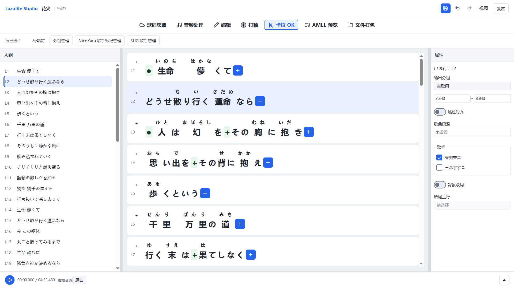
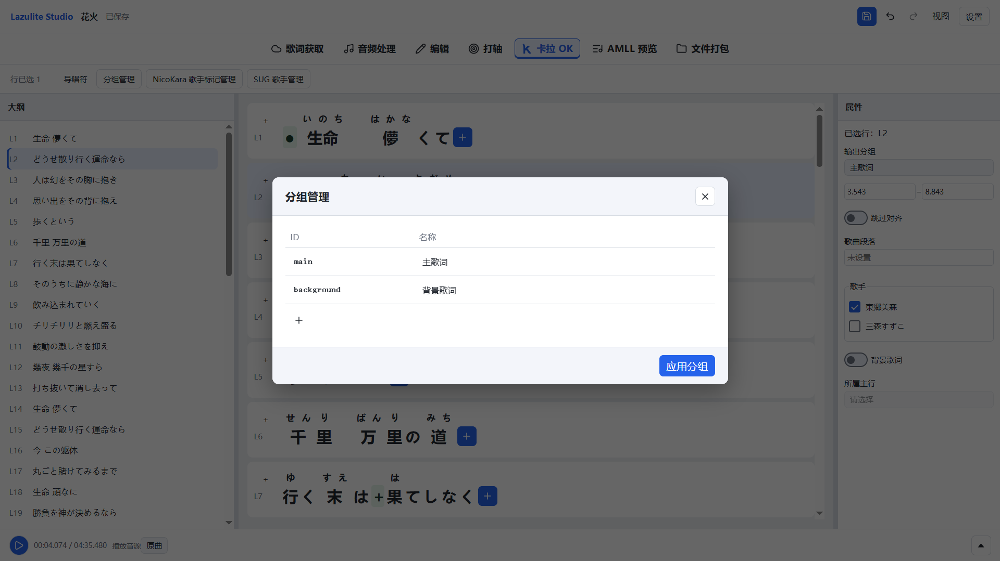
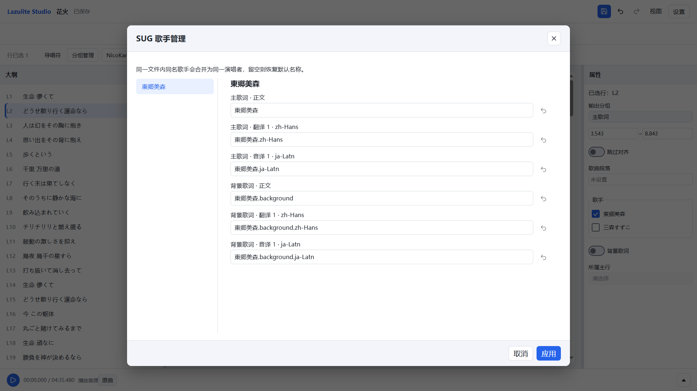
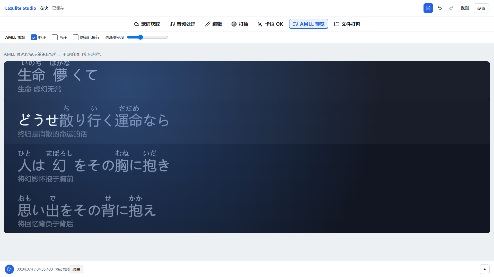
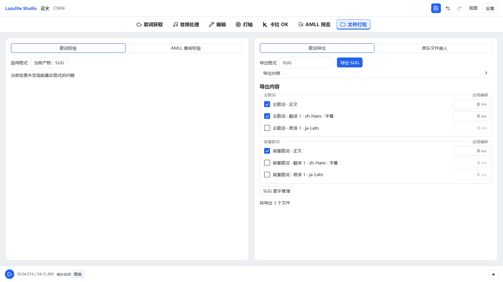

# 4. 卡拉 OK、预览与导出打包

完成歌词编辑与时间轴校对后，Lazulite Studio 支持进一步配置卡拉 OK 导唱符、输出分组与歌手名称映射，通过 AMLL 预览实时检验动态效果，并导出为面向现代卡拉 OK 制作工具 [Lin-K](https://github.com/karaoke-studio/karaoke-studio)、[NicoKaraMaker 3](https://github.com/shinta0806/NicoKaraMaker3) 或各类音乐播放器的歌词与内嵌音频文件。

---

## 卡拉 OK 编辑：导唱符、分组与歌手映射

切换到**卡拉 OK**界面，歌词画布保持与简洁编辑一致的“读音 / 正文”两行布局，并在此基础上显示导唱符槽位以及右侧的**输出分组**属性：

### 导唱符（Wipe Guide）
- **插入位置**：在每一行歌词行首（行号旁的 `+` 或绿色圆点 `●`），以及同一行内**相邻词之间存在时间空隙处**、同一词内**相邻注音之间存在时间空隙处**，都会出现可点击的 `+` 槽位。点击即可插入一个导唱符（插入后显示为绿色圆点 `●`）。
- **微调与删除**：导唱符的起止时间既可以在右侧属性栏精确修改，也可以在时间轴的**导唱**轨上直接拖动条块边界；选中导唱符后按 `Delete` 键（或右键删除）即可移除。
- **数据边界**：导唱符和卡拉 OK 分组配置保存在 Studio 工程中，专门用于**导出 SUG / NicoKara** 项目文件，**不会写入导出的标准 TTML 文件**。

### 分组管理

默认情况下，Studio 会将所有正文主行归入“主歌词”（`main`）分组，将所有背景行归入“背景歌词”（`background`）分组，并在导出卡拉 OK 项目时分别输出为独立的文件。如果需要更细的分轨（例如将男女对唱的上排、下排或特殊合唱段拆分为独立轨道文件），可点击顶部工具栏的**分组管理**：

新增自定义分组后，在画布中选中对应的歌词行，在右侧属性栏的**输出分组**下拉框中即可将该行分配到指定分组。此外，每一条翻译轨道和音译轨道在导出时也会各自作为独立的附属文件输出。

### SUG 歌手管理（面向 Lin-K 卡拉 OK 制作）

**导出 SUG** 能够生成符合 [StrangeUtaGame](https://github.com/karaoke-studio/StrangeUtaGame) 0.3.0 规范的项目文件，可直接导入其姊妹项目——现代化的卡拉 OK 视频制作工具 **[Lin-K](https://github.com/karaoke-studio/karaoke-studio)** 中使用。在 SUG 格式中，导唱符以及行级、字级的歌手标记都使用原生结构化字段承载。

为了方便导入 Lin-K 后针对不同轨道（如主歌词、背景歌词、翻译、音译）分别绑定不同的字幕样式，可以点击顶部工具栏的**SUG 歌手管理**配置每个歌手在各输出文件中的实际演唱者名称：

- **同一歌手在不同分组/轨道输出不同名称**：如上图所示，同一个歌手 `東郷美森` 在主歌词正文、主歌词翻译、主歌词音译以及背景歌词的各轨道中，默认会带有不同的后缀（如 `東郷美森.zh-Hans`、`東郷美森.background`），也可自由修改为任意自定义名称，导入 Lin-K 后即可按演唱者名称轻松区分不同分轨的显示样式。
- **多个歌手在同一分组中合并**：如果将两个不同的 TTML 歌手在同一个输出文件中填写为相同的 SUG 演唱者名称，导出该文件时会自动将它们合并为同一个演唱者。清空输入框或点击右侧重置按钮即可恢复默认名称。

### NicoKara 歌手标记管理
若下游使用传统的 [NicoKaraMaker 3](https://github.com/shinta0806/NicoKaraMaker3)，可点击工具栏上的“NicoKara 歌手标记管理”（设计参考了 StrangeUtaGame 的“分色助手”）。Studio 会直接根据 TTML 中配置的行级与词级歌手属性，在导出 `.kra` 歌词文本时自动在歌手切换处插入对应的触发标记字符串。

---

## AMLL 实时预览

切换到 **AMLL 预览**界面，可以直接在工作台内预览当前歌词草稿在 [Apple Music-like Lyrics](https://github.com/amll-dev/applemusic-like-lyrics) 渲染组件下的实际滚动、逐字渐变与背景行效果：

- 顶部工具栏可随时开关**翻译**、**音译**、**隐藏已播行**，并拖动滑块调整**词渐变宽度**。
- 需要注意的是，受限于 AMLL 渲染器本身的歌词模型简化，预览画面中每个主行仅展示单条关联背景行，这只是预览器的显示限制，不会影响项目实际保存的多条背景行与完整 TTML 数据。

---

## 文件打包：歌词导出与音乐文件嵌入

切换到**文件打包**界面，左侧为实时校验面板（包含**歌词校验**与**AMLL 兼容校验**），右侧为**歌词导出**与**音乐文件嵌入**两个页签：

### 歌词导出与实时格式校验
1. **选择导出格式**：在右侧“导出格式”下拉框中选择目标格式，支持：
   - **TTML**：无损保留全部注音、多轨翻译/音译、角色与声优关联、词级歌手与背景行结构。
   - **SUG（StrangeUtaGame 0.3.0）**：打包为包含各分组正文及所选翻译/音译轨道 `.json` 文件的 ZIP 包，推荐导入 **[Lin-K](https://github.com/karaoke-studio/karaoke-studio)** 制作卡拉 OK 视频。
   - **NicoKara（`.kra`）**：打包为可输入 NicoKaraMaker 3 的 ZIP 包（含厘秒时间、注音标签、歌手触发串与占位图）。
   - **LRC / 扩展 LRC / ESLRC / QRC / YRC / LYS** 与 **ASS 字幕**：面向各类音乐播放器与通用字幕工具。
2. **针对当前产物的实时校验**：左侧“歌词校验”会自动切换为检查当前选中的导出格式（例如“当前产物：SUG”），列出所有会阻塞导出或可能导致下游工具显示异常的问题；点击问题条目可直接定位到对应的歌词行或词进行修复。若准备向 AMLL TTML DB 投稿，可切换到“AMLL 兼容校验”页签逐条核对。
3. **勾选导出内容与全局偏移**：在导出 SUG 或 NicoKara 时，下方“导出内容”列表可以按分组自由勾选需要导出的正文、翻译和音译轨道文件，并支持为每个输出文件单独设置**全局偏移（`ms`）**（正值延后、负值提前）。展开“导出对照”还可直接预览将要生成的文本或 JSON 结构。

### 音乐文件嵌入
切换到右侧的**音乐文件嵌入**页签，可将当前已保存的歌词直接写入源音频文件的副本并下载（不会修改项目原始音频）：
- **MP4 / M4A 文件**：支持向标准的 **STPP 字幕轨道**写入完整 TTML 内嵌歌词（可配合支持 TTML 内嵌轨道的本地播放器如 [Musicovite](https://github.com/zet-wu/Musicovite) 使用），同时可选向 `©lyr` 元数据标签写入兼容的普通或扩展 LRC。
- **MP3 与 FLAC 文件**：支持向 MP3 的 `USLT` 标签、FLAC 的 `LYRICS` Vorbis Comment 标签写入普通或扩展 LRC，兼容绝大多数本地音乐播放器。

---

返回：[Lazulite Studio 使用教程目录](../usage-tutorial.md)
